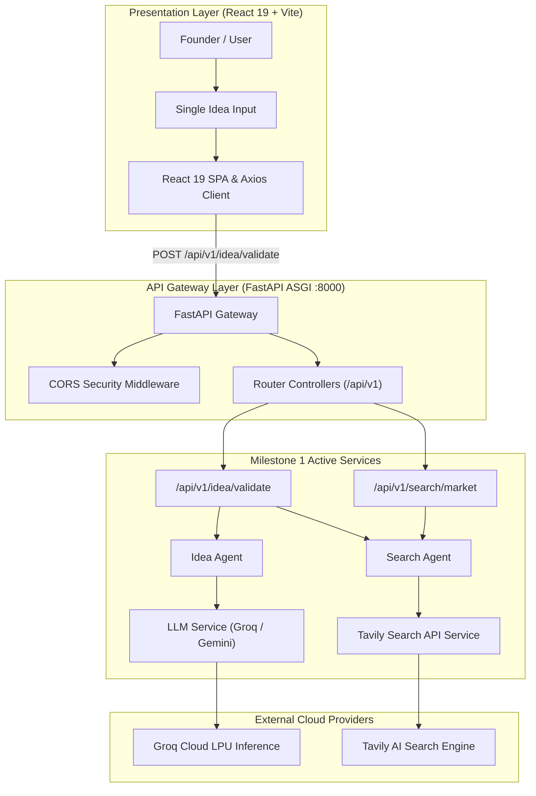

# AI-Based Startup Idea Validator with Market Analysis Assistance

<div align="center">


<p align="center">
  <strong>An Enterprise-Grade Multi-Agent AI System for Automated Startup Idea Feasibility Scoring, Real-Time Market Intelligence via Tavily Search, Competitor Moat Analysis, and Management Consulting Dossier Synthesis.</strong>
</p>

[Research Note](docs/research-note.md) • [System Architecture](docs/architecture.md) • [Agent Design](docs/agent-design.md) • [Data Models](docs/data-models.md) • [Agile Sprint Plan](agile/SprintPlan.md) • [Task Sheet](agile/TaskSheet.md)

</div>

---

## 1. Project Overview

### Problem Statement
Over **90% of early-stage startups fail**, and the leading cause is **lack of market demand**—founders invest capital and months of effort building products before validating customer pain points, competitor landscapes, and unit economics. Traditional market research is slow, expensive, and often biased.

### Solution
The **AI-Based Startup Idea Validator** automates early-stage venture evaluation. A founder submits a raw, natural language concept (e.g., *"An AI platform that helps students prepare for interviews with real-time vocal feedback"*). The platform:
1. Deconstructs the concept into structured venture dimensions (target audience, business model, problem-solution fit).
2. Performs real-time web research using the **Tavily AI Search API** to identify live competitors, growth trends, and industry developments.
3. Synthesizes a structured, executive-grade validation brief in seconds.

---

## 2. Milestone 1 Scope

As defined in the **Infosys Springboard Virtual Internship 7.0** curriculum, Milestone 1 focuses on foundational architecture, core agent extraction, and real-time search integration:

### ✅ Included in Milestone 1
- **Decoupled Architecture:** Clean client-server separation between a React 19 frontend and a FastAPI backend.
- **Minimalist Presentation Layer:** Professional, Notion/ChatGPT-style single-input interface (ONE textarea, ONE action button, progressive loading state, ONE comprehensive report view).
- **Core LLM Idea Extraction:** `IdeaAgent` extracting structured venture parameters using Groq Cloud (Llama 3.3 / Qwen / GPT-OSS) or Google Gemini.
- **Live Search Intelligence:** `SearchAgent` formulating 5 targeted market research vectors and querying the live **Tavily Search API**.
- **Strict Error Handling:** Immediate HTTP 400 with meaningful JSON (`{"error": "GROQ_API_KEY not configured."}`) if API keys are missing. **Zero placeholder or synthetic fallback data.**
- **Zero Database Requirement:** Runs in-memory with Pydantic v2 domain schemas. No PostgreSQL or Docker database dependencies.
- **Automated CI/CD:** GitHub Actions workflows running backend unit tests and frontend build validation.

### ⏳ Future Planned Features (Milestone 2 and Beyond)
- Multi-agent orchestration graph (Market Agent, Competitor Agent, SWOT Agent, Report Agent).
- PostgreSQL database storage and SQLAlchemy ORM models.
- User authentication, session management, and saved idea history.
- Downloadable PDF report generation.

---

## 3. System Architecture



---

## 4. Repository Folder Structure

```text
AI-Startup-Idea-Validator/
├── .github/
│   └── workflows/
│       ├── backend.yml            # Automated pytest & syntax validation CI
│       └── frontend.yml           # Automated Vite build & lint CI
│
├── agile/
│   ├── SprintPlan.md              # Agile Scrum Sprint 1 plan & Definition of Done
│   └── TaskSheet.md               # Team task allocations & PR tracking (Lakshya, Poojitha, Sahil, Supritha)
│
├── backend/
│   ├── app/
│   │   ├── agents/
│   │   │   ├── idea_agent.py      # Core Idea Agent (LLM extraction)
│   │   │   └── search_agent.py    # Core Search Agent (Tavily query generation)
│   │   │
│   │   ├── api/
│   │   │   └── routes/
│   │   │       ├── health.py      # GET /api/v1/health/ probe
│   │   │       ├── idea.py        # POST /api/v1/idea/validate
│   │   │       └── search.py      # POST /api/v1/search/market
│   │   │
│   │   ├── core/
│   │   │   ├── config.py          # Centralized Pydantic BaseSettings
│   │   │   └── logging.py         # Structured logging configuration
│   │   │
│   │   ├── schemas/
│   │   │   ├── idea_schema.py     # Pydantic request/response schemas
│   │   │   └── response_schema.py # Standard ApiResponse envelope
│   │   │
│   │   ├── services/
│   │   │   ├── llm_service.py     # Multi-provider LLM client (Groq / Gemini)
│   │   │   └── tavily_service.py  # Live Tavily Search API client
│   │   │
│   │   ├── utils/
│   │   │   └── helpers.py         # ID generator and sanitizers
│   │   │
│   │   └── main.py                # ASGI application factory
│   │
│   ├── tests/
│   │   └── test_health.py         # 11 unit & integration tests
│   ├── requirements.txt           # Python dependencies
│   ├── .env.example               # Backend environment variables template
│   └── README.md                  # Backend guide
│
├── frontend/
│   ├── src/
│   │   ├── api/
│   │   │   ├── client.js          # Centralized Axios client & error interceptor
│   │   │   └── ideaApi.js         # API integration client methods
│   │   ├── components/common/     # Button, Card, Header, Footer
│   │   ├── pages/
│   │   │   ├── HomePage.jsx       # Overview landing
│   │   │   └── ValidatorPage.jsx  # Single textarea, submit button & report view
│   │   ├── App.jsx                # React Router DOM
│   │   └── main.jsx               # React 19 entrypoint
│   ├── package.json
│   ├── vite.config.js
│   └── tailwind.config.js
│
├── docs/
│   ├── research-note.md           # Frameworks, Multi-Agent patterns & Search API analysis
│   ├── architecture.md            # Clean Architecture specification
│   ├── agent-design.md            # Multi-agent coordination blueprint
│   ├── data-models.md             # Pydantic domain models & schemas
│   └── milestone-1.md             # Milestone 1 overview
│
├── .gitignore
├── LICENSE
└── README.md
```

---

## 5. Environment Variables & Configuration

Create a `.env` file in `backend/` (or copy from `backend/.env.example`):

```bash
cp backend/.env.example backend/.env
```

```env
# Server Configuration
APP_NAME="AI-Startup-Idea-Validator"
ENVIRONMENT="development"
PORT=8000
API_PREFIX="/api/v1"
FRONTEND_URL="http://localhost:5173"

# 1. AI LLM Provider Configuration
# Choose active provider: 'groq' | 'gemini' | 'openai'
DEFAULT_LLM_PROVIDER="groq"

# Groq Cloud API Key (Sign up free: https://console.groq.com/keys)
GROQ_API_KEY="gsk_your_groq_api_key_here"

# (Optional) Google Gemini API Key (Sign up free: https://aistudio.google.com/app/apikey)
GEMINI_API_KEY="your_gemini_api_key_here"

# 2. Real-Time Web Search API
# Tavily API Key (1,000 free searches/month: https://tavily.com)
TAVILY_API_KEY="tvly-your_tavily_api_key_here"
```

---

## 6. Installation & Execution Guide

### Prerequisites
- **Python:** 3.12+ (or 3.13+)
- **Node.js:** 20+
- **npm:** 10+
- **Git**

### A. Backend Setup & Launch

```powershell
# 1. Navigate to backend directory
cd backend

# 2. Create and activate virtual environment
python -m venv .venv

# On Windows PowerShell:
.\.venv\Scripts\Activate.ps1
# On macOS/Linux:
source .venv/bin/activate

# 3. Install dependencies
pip install --upgrade pip
pip install -r requirements.txt

# 4. Start the FastAPI server
python -m uvicorn app.main:app --host 127.0.0.1 --port 8000 --reload
```
* **API Documentation (Swagger UI):** [http://127.0.0.1:8000/docs](http://127.0.0.1:8000/docs)
* **Health Check Probe:** [http://127.0.0.1:8000/api/v1/health/](http://127.0.0.1:8000/api/v1/health/)

### B. Frontend Setup & Launch

```powershell
# In a separate terminal, navigate to frontend
cd frontend

# 1. Install dependencies
npm install

# 2. Start the Vite development server
npm run dev
```
* **Web Application:** [http://localhost:5173](http://localhost:5173)

---

## 7. Core AI & Search Integration

### Idea Extraction (`IdeaAgent`)
The `IdeaAgent` receives raw, unstructured user input and instructs the LLM via strict JSON schema prompting to extract:
* `startup_name`: Working venture name or brand.
* `industry`: Primary market categorization.
* `problem_statement`: Verified user pain point.
* `proposed_solution`: Automated product approach.
* `target_customers`: Intended demographic or B2B persona.
* `business_model`: Commercial monetization structure.
* `value_proposition`: Primary defensible value driver.

### Live Market Search (`SearchAgent` + Tavily)
The `SearchAgent` generates 5 multi-vector queries:
1. `"{startup_name}" {industry} {problem} market trends industry developments`
2. `"{startup_name}" {industry} {problem} market demand growth opportunities`
3. `"{startup_name}" {industry} {problem} competitors competing products alternative solutions`
4. `"{startup_name}" {industry} {problem} customer problems pain points unmet needs`
5. `"{startup_name}" {industry} {problem} industry gaps emerging opportunities`

Each query is executed against the live Tavily Search API, returning genuine titles, URLs, pre-cleaned content snippets, and relevance scores.

---

## 8. Example Input & Output

### Example Request (`POST /api/v1/idea/validate`)

```json
{
  "idea": "I want to build an AI platform that helps students prepare for job interviews through real-time vocal analysis and mock coding sessions."
}
```

### Example Structured Response

```json
{
  "success": true,
  "data": {
    "id": "idea_8f21a4",
    "title": "InterviewPrep AI",
    "status": "completed",
    "scores": {
      "overall": 84.5,
      "feasibility": 88.0,
      "market_demand": 85.0,
      "uniqueness": 80.5
    },
    "executive_summary": "InterviewPrep AI addresses acute friction in graduate placement by delivering automated, real-time vocal feedback and adaptive coding interview simulations.",
    "startup_overview": "An AI-powered interview coaching and skill-assessment platform targeting tertiary students and career switchers.",
    "problem_statement": "Students face high anxiety and lack personalized, cost-effective feedback during competitive tech and professional interviews.",
    "proposed_solution": "Real-time speech-pattern analysis, behavioral feedback, and simulated technical mock interviews powered by specialized LLMs.",
    "target_customers": "University seniors, coding bootcamp graduates, and entry-level job seekers.",
    "industry": "EdTech & Career Services",
    "business_model": "Freemium Subscription (SaaS) with university B2B licensing",
    "market_research": "Real-time market signals indicate accelerating demand for AI career development tools with expanding corporate hiring automation.",
    "market_trends": [
      "Migration toward automated recruitment screening tools.",
      "Growing university adoption of career placement SaaS.",
      "Increasing demand for real-time vocal and biometric confidence coaching."
    ],
    "competitor_analysis": {
      "direct_competitors": [
        {"name": "Pramp", "vulnerability": "Requires human peer matching; limited AI vocal diagnostics"},
        {"name": "Interviewing.io", "vulnerability": "High per-session pricing; limited entry-level focus"}
      ],
      "indirect_competitors": ["University career centers and generic mock interview YouTube guides"],
      "defensive_moats": ["Proprietary speech-analysis feedback loops and university LMS integrations"]
    },
    "swot_analysis": {
      "strengths": ["Automated 24/7 availability", "Zero human-evaluator scheduling overhead", "Scalable unit economics"],
      "weaknesses": ["Requires continuous calibration across diverse vocal accents", "Early customer acquisition costs"],
      "opportunities": ["B2B enterprise licensing to university career centers", "Expansion into corporate recruitment screening"],
      "threats": ["Incumbent job boards bundling free AI practice tools", "Shifting corporate interview formats"]
    },
    "opportunities": ["Expansion into technical whiteboard coding", "Enterprise pre-screening partnerships"],
    "risks": ["Vocal bias across regional accents", "Fast follower features from established job boards"],
    "recommendations": ["Pilot with 3 university coding bootcamps", "Implement accent-agnostic speech models"],
    "overall_validation_score": 84.5,
    "final_conclusion": "Strong commercial viability with high addressable demand. Prioritize university partnerships as a low-CAC beachhead."
  },
  "message": "Idea validated successfully via multi-agent pipeline",
  "errors": null
}
```

---

## 9. Automated Testing & Quality Assurance

The backend includes a comprehensive `pytest` and `unittest` verification suite:

```powershell
# Run the complete test suite
.\backend\.venv\Scripts\pytest.exe backend -v
```

### Test Coverage Highlights (11 Scenarios)
1. `test_health_check_controller`: Asserts service status, version, and environment metadata.
2. `test_app_routes_registration`: Validates all required routes (`/`, `/health`, `/idea/validate`, `/idea/{id}`, `/search/market`, `/docs`).
3. `test_idea_validation_controller`: Tests composite submission payload parsing.
4. `test_single_input_idea_validation`: Tests raw single-string natural language validation.
5. `test_get_idea_validation_by_id`: Validates dossier retrieval by unique ID.
6. `test_market_search_controller`: Validates Tavily market search response structure.
7. `test_market_search_missing_key_error`: Asserts strict HTTP 400 when `TAVILY_API_KEY` is missing.
8. `test_idea_validate_missing_key_error`: Asserts strict HTTP 400 when LLM key is missing.
9. Pytest standalone verification hooks.

---

## 10. Known Limitations

- **In-Memory Volatility:** In Milestone 1, validation dossiers are generated in-memory and not stored in a persistent database. Server restarts reset past validations.
- **Network Dependency:** Real-time market search requires an outbound internet connection to reach `https://api.tavily.com`.
- **API Quotas:** Tavily's free tier provides 1,000 queries/month. Groq Cloud provides free rate-limited tier access.

---

## 11. Deployment Strategy

The application is structured for rapid deployment across modern cloud platforms:

* **Backend Deployment (Render / Railway / Fly.io):**
  * Runtime: Python 3.12+ Dockerfile or Python buildpack.
  * Start Command: `uvicorn app.main:app --host 0.0.0.0 --port $PORT`
  * Environment Variables: `GROQ_API_KEY`, `TAVILY_API_KEY`, `FRONTEND_URL`.
* **Frontend Deployment (Vercel / Netlify):**
  * Framework: Vite React.
  * Build Command: `npm run build`
  * Output Directory: `dist`
  * Environment Variables: `VITE_API_BASE_URL` pointing to the deployed backend URL.

---

## 12. Team & Acknowledgments

Developed as part of the **Infosys Springboard Virtual Internship 7.0**.

* **Lakshya Singhal** — Project Lead & Full Stack Architect
* **Poojitha B** — Senior AI & Backend Engineer
* **Sahil** — Senior Backend & Search Engineer
* **Supritha** — Senior Frontend & UI/UX Engineer

**License:** MIT License
