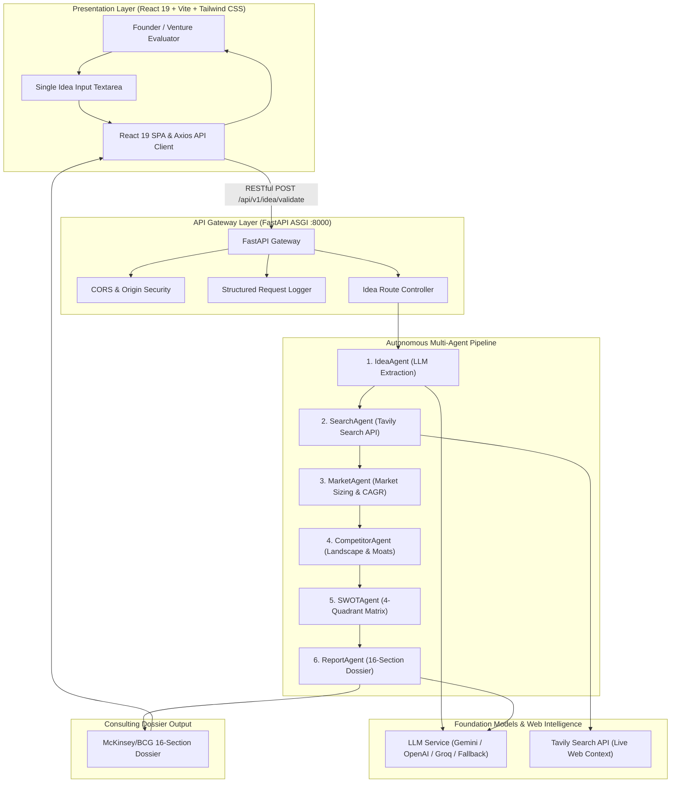

# AI-Based Startup Idea Validator with Market Analysis Assistance

<div align="center">


<p align="center">
  <strong>An Enterprise-Grade, Multi-Agent AI System for Automated Startup Idea Feasibility Scoring, Real-Time Market Intelligence via Tavily Search, Competitor Moat Analysis, and Management Consulting Dossier Synthesis.</strong>
</p>

[System Architecture](docs/architecture.md) • [API Contract Flow](docs/api-flow.md) • [Agent Design](docs/agent-design.md) • [Data Models](docs/data-models.md) • [Milestone 1 Report](docs/milestone-1.md)

</div>

---

## 1. Project Overview

### What Problem Does This Project Solve?
More than **90% of early-stage startups fail**, and the number-one reason is **building something the market does not want or need**. Founders, university incubators, and early-stage venture evaluators frequently spend weeks performing fragmented manual market research:
- Guessing market sizes without grounded validation.
- Overlooking existing competitors or dominant legacy alternatives.
- Formulating subjective, biased SWOT assessments.
- Struggling to articulate defensible business models and unit economics.

The **AI-Based Startup Idea Validator** transforms this process into an automated, data-grounded workflow. By entering a single plain-language startup concept, founders receive a comprehensive, 16-section management consulting brief in under 15 seconds.

### Why Is Startup Validation Important?
- **Capital & Time Efficiency:** Prevents founders and investors from spending months building products with no market demand.
- **Data Grounding:** Combines Large Language Models (LLMs) with live web search via Tavily to ensure insights reflect real competitors and current industry trends rather than generic assumptions.
- **Defensibility:** Evaluates customer switching costs, network effects, and defensive moats early in the venture lifecycle.
- **Consulting-Grade Output:** Produces structured briefs in the style of top management consulting firms (McKinsey, BCG, Deloitte) with zero chart clutter and clear executive typography.

---

## 2. Core Features

- **Single-Input Minimalist Interface:** Accepts one natural-language description (e.g. *"I want to build an AI platform that helps students prepare for interviews."*) without forcing users to fill out complex forms for budgets, business models, or customer segments.
- **Autonomous LLM Idea Extraction:** Analyzes unstructured text to extract startup name, problem statement, proposed solution, target customers, industry vertical, business model, and primary value proposition.
- **Live Market Web Intelligence:** Integrates real-time Tavily Search API queries to identify live competitors, recent industry developments, and current market demand signals.
- **Target Market Sizing (TAM / SAM / SOM / CAGR):** Provides qualitative and quantitative sizing breakdowns grounded in the specific sector.
- **Competitor Landscape & Moat Mapping:** Identifies direct incumbent vendors, indirect substitutes, competitor vulnerabilities, and defensible moats.
- **4-Quadrant Strategic SWOT Matrix:** Evaluates internal strengths, operational weaknesses, external growth opportunities, and macro threats.
- **16-Section Management Consulting Dossier:** Delivers an investor-ready evaluation report covering Executive Summary, Startup Overview, Problem Statement, Solution, Customers, Industry, Business Model, Market Research, Trends, Competitor Analysis, SWOT, Opportunities, Risks, Recommendations, Validation Scores, and Final Conclusion.
- **Resilient Multi-Provider Fallback:** Supports Google Gemini API (priority 1), OpenAI (priority 2), and Groq (priority 3), with built-in heuristic fallback so the platform never crashes even if external keys or networks are offline.

---

## 3. System Architecture & Workflow

The platform adheres to **Clean Architecture** and **Modular Component Design**:



### Complete Idea Processing Workflow
1. **User Submission:** The user inputs an idea into a single textarea and clicks `"Validate Idea"`.
2. **Step 1 - Idea Extraction (`IdeaAgent`):** `LLMService` parses the raw idea into structured attributes (problem, solution, audience, industry vertical, business model).
3. **Step 2 - Live Web Search (`SearchAgent`):** Formulates targeted queries and calls `TavilySearchService` to fetch live market trends, incumbent software, and competitor articles.
4. **Step 3 - Market Sizing (`MarketAgent`):** Analyzes TAM, SAM, SOM, CAGR, and industry demand drivers for the vertical.
5. **Step 4 - Competitor Analysis (`CompetitorAgent`):** Maps direct incumbents, indirect substitutes, and sustainable defensive moats.
6. **Step 5 - Strategic SWOT (`SWOTAgent`):** Cross-correlates findings into an objective 4-quadrant strategic matrix.
7. **Step 6 - Report Synthesis (`ReportAgent`):** Compiles the 16-section management consulting brief with overall validation score (0–100 scale).
8. **Client Rendering:** React renders the structured cards with print capability and instant reset.

---

## 4. Tech Stack

### Frontend
- **Framework:** [React 19](https://react.dev/) (Modern component-driven architecture)
- **Build Tool:** [Vite 6](https://vitejs.dev/) (Optimized production bundles and instant HMR)
- **Styling:** [Tailwind CSS 3.4](https://tailwindcss.com/) (Minimalist, responsive utility-first design)
- **HTTP Client:** [Axios](https://axios-http.com/) (Centralized interceptors and timeout handling)
- **Routing:** [React Router DOM v7](https://reactrouter.com/) (Declarative client routing)
- **Iconography:** [Lucide React](https://lucide.dev/) (Clean, modern SVG icons)

### Backend
- **Runtime:** [Python 3.12+](https://www.python.org/)
- **Framework:** [FastAPI](https://fastapi.tiangolo.com/) (High-performance asynchronous ASGI framework)
- **Server:** [Uvicorn](https://www.uvicorn.org/) (Production ASGI server)
- **Data Validation:** [Pydantic v2](https://docs.pydantic.dev/) & `pydantic-settings`
- **HTTP Client:** [HTTPX](https://www.python-httpx.org/) (Asynchronous HTTP for external APIs)
- **Data Persistence:** In-Memory Domain Objects (Milestone 1 architecture; zero database overhead)

### AI & Search Services
- **Google Gemini API:** `google-genai` / `gemini-2.0-flash` with exponential backoff retries (Priority 1)
- **OpenAI GPT:** `openai` / `gpt-4o-mini` (Priority 2)
- **Groq:** `groq` / `llama-3.3-70b-versatile` (Priority 3)
- **Tavily AI Search:** `tavily-python` for real-time web research and market intelligence
- **Heuristic Engine:** Offline deterministic synthesis fallback for resilience

### Deployment
- **Frontend Target:** Vercel (Edge CDN)
- **Backend Target:** Render (Web Service Container)

---

## 5. Repository Directory Structure

```
AI-Startup-Idea-Validator/
├── .github/
│   └── workflows/
│       ├── backend.yml            # CI: Python compileall syntax check & pytest suite
│       └── frontend.yml           # CI: Node.js setup, dependencies, and Vite build
│
├── backend/
│   ├── app/
│   │   ├── api/
│   │   │   ├── routes/
│   │   │   │   ├── __init__.py    # Router exports
│   │   │   │   ├── health.py      # Liveness probe (/api/v1/health/)
│   │   │   │   ├── idea.py        # Validation endpoints (/api/v1/idea/*)
│   │   │   │   └── search.py      # Tavily search endpoint (/api/v1/search/*)
│   │   │   └── __init__.py
│   │   │
│   │   ├── agents/                # Autonomous AI Multi-Agent Network
│   │   │   ├── __init__.py
│   │   │   ├── idea_agent.py      # Structured attribute extraction agent
│   │   │   ├── search_agent.py    # Tavily live web research agent
│   │   │   ├── market_agent.py    # TAM / SAM / SOM market sizing agent
│   │   │   ├── competitor_agent.py# Competitive landscape & moat agent
│   │   │   ├── swot_agent.py      # Strategic SWOT matrix agent
│   │   │   └── report_agent.py    # 16-section consulting dossier synthesis agent
│   │   │
│   │   ├── core/
│   │   │   ├── __init__.py
│   │   │   ├── config.py          # Centralized Pydantic Settings & CORS rules
│   │   │   └── logging.py         # Standardized structured logging configuration
│   │   │
│   │   ├── models/                # Domain Entities (In-Memory)
│   │   │   ├── __init__.py
│   │   │   ├── idea.py            # StartupIdea & ValidationReport entities
│   │   │   └── search_result.py   # SearchResultCache domain entity
│   │   │
│   │   ├── schemas/               # Pydantic v2 Request/Response Data Contracts
│   │   │   ├── __init__.py
│   │   │   ├── idea_schema.py     # IdeaCreateRequest & 16-section IdeaValidationResponse
│   │   │   └── response_schema.py # Universal ApiResponse envelope
│   │   │
│   │   ├── services/              # Foundation Model & External Adapters
│   │   │   ├── __init__.py
│   │   │   ├── llm_service.py     # Multi-provider LLM service (Gemini, OpenAI, Groq)
│   │   │   └── tavily_service.py  # Live Tavily Search API client wrapper
│   │   │
│   │   ├── utils/
│   │   │   ├── __init__.py
│   │   │   └── helpers.py         # Sanitizers, ID generators, and helpers
│   │   │
│   │   └── main.py                # FastAPI application entrypoint & middleware
│   │
│   ├── tests/
│   │   ├── __init__.py
│   │   └── test_health.py         # Comprehensive test suite (routes, agents, schema)
│   │
│   ├── requirements.txt           # Python backend dependencies
│   ├── .env.example               # Backend environment variables template
│   └── README.md                  # Backend setup guide
│
├── frontend/
│   ├── public/
│   │   └── favicon.svg            # Branded application favicon
│   │
│   ├── src/
│   │   ├── api/
│   │   │   ├── client.js          # Centralized Axios client & interceptors
│   │   │   └── ideaApi.js         # Frontend API methods (validate, health, search)
│   │   │
│   │   ├── assets/
│   │   │   └── logo.svg           # Application logo
│   │   │
│   │   ├── components/
│   │   │   └── common/            # Clean UI primitives
│   │   │       ├── Header.jsx     # Navigation bar with route highlight
│   │   │       ├── Footer.jsx     # Minimalist footer
│   │   │       ├── Button.jsx     # Reusable button with variants
│   │   │       └── Card.jsx       # Standard structured card container
│   │   │
│   │   ├── pages/
│   │   │   ├── HomePage.jsx       # Landing overview & quick start
│   │   │   ├── ValidatorPage.jsx  # Single-input form & 16-section consulting dossier
│   │   │   ├── AboutPage.jsx      # Architecture, internship details, and team info
│   │   │   └── NotFoundPage.jsx   # 404 error page
│   │   │
│   │   ├── styles/
│   │   │   └── index.css          # Tailwind CSS directives
│   │   │
│   │   ├── App.jsx                # React Router DOM route hierarchy
│   │   └── main.jsx               # React 19 entrypoint
│   │
│   ├── index.html                 # SPA HTML shell
│   ├── package.json               # NPM package manifest
│   ├── vite.config.js             # Vite configuration with /api proxy
│   ├── tailwind.config.js         # Tailwind design system configuration
│   └── README.md                  # Frontend setup guide
│
└── docs/                          # Architectural Documentation
    ├── architecture.md            # Clean Architecture specification
    ├── api-flow.md                # REST API schemas & sequence diagrams
    ├── agent-design.md            # Multi-agent coordination blueprint
    ├── data-models.md             # Domain entities & schema contracts
    └── milestone-1.md             # Milestone 1 delivery report
```

---

## 6. Installation & Setup

### Prerequisites
- **Python:** Version 3.12 or newer
- **Node.js:** Version 20 or newer
- **npm:** Version 10 or newer
- **Git**

### Step-by-Step Installation

1. **Clone the repository:**
   ```bash
   git clone https://github.com/lakshyasinghal08/AI-Startup-Idea-Validator.git
   cd AI-Startup-Idea-Validator
   ```

2. **Backend Setup:**
   ```bash
   # Navigate to backend
   cd backend

   # Create virtual environment
   python -m venv venv

   # Activate virtual environment
   # On Windows PowerShell:
   .\venv\Scripts\Activate.ps1
   # On macOS/Linux:
   source venv/bin/activate

   # Install dependencies
   pip install --upgrade pip
   pip install -r requirements.txt
   ```

3. **Frontend Setup:**
   ```bash
   # Navigate to frontend (from repository root)
   cd frontend

   # Install dependencies
   npm install
   ```

---

## 7. Environment Variables

Create a `.env` file in the `backend/` directory using `backend/.env.example` as a template:

```env
# Application Settings
APP_NAME=AI-Based Startup Idea Validator
ENVIRONMENT=development
PORT=8000
API_PREFIX=/api/v1

# CORS Configuration
FRONTEND_URL=http://localhost:5173

# LLM Provider Configuration
# Set to 'auto', 'gemini', 'openai', or 'groq'
DEFAULT_LLM_PROVIDER=auto

# API Keys (Optional: system uses intelligent heuristic fallback if not provided)
GEMINI_API_KEY=your-gemini-api-key-here
OPENAI_API_KEY=your-openai-api-key-here
GROQ_API_KEY=your-groq-api-key-here
TAVILY_API_KEY=your-tavily-api-key-here
```

| Variable | Description | Default | Required |
| :--- | :--- | :--- | :--- |
| `APP_NAME` | Project title for OpenAPI documentation | `AI-Based Startup Idea Validator` | Optional |
| `ENVIRONMENT` | Execution mode (`development` / `production`) | `development` | Optional |
| `PORT` | ASGI server port | `8000` | Optional |
| `FRONTEND_URL` | Frontend origin for CORS whitelist | `http://localhost:5173` | Recommended |
| `DEFAULT_LLM_PROVIDER` | Primary LLM provider (`auto`, `gemini`, `openai`, `groq`) | `auto` | Recommended |
| `GEMINI_API_KEY` | Google Gemini API Key | None | Optional (Fallback active) |
| `OPENAI_API_KEY` | OpenAI API Key | None | Optional (Fallback active) |
| `GROQ_API_KEY` | Groq API Key | None | Optional (Fallback active) |
| `TAVILY_API_KEY` | Tavily Search API Key | None | Optional (Fallback active) |

---

## 8. Running the Project

### Running Backend
```powershell
# From the repository root (with virtual environment active)
$env:PYTHONPATH="backend"
python -m uvicorn app.main:app --host 127.0.0.1 --port 8000 --reload
```
- Interactive Swagger UI: [http://127.0.0.1:8000/docs](http://127.0.0.1:8000/docs)
- Health Probe: [http://127.0.0.1:8000/api/v1/health/](http://127.0.0.1:8000/api/v1/health/)

### Running Frontend
```powershell
# In a separate terminal
cd frontend
npm run dev
```
- Web Application: [http://localhost:5173](http://localhost:5173)

---

## 9. API Endpoints

All endpoints are versioned under `/api/v1`:

| Method | Endpoint | Description | Request Body | Response Model |
| :--- | :--- | :--- | :--- | :--- |
| `GET` | `/` | Root server health and metadata | None | JSON |
| `GET` | `/api/v1/health/` | Service liveness probe | None | JSON |
| `POST` | `/api/v1/idea/validate` | Multi-agent validation pipeline | `{"idea": "string"}` | `ApiResponse[IdeaValidationResponse]` |
| `GET` | `/api/v1/idea/{idea_id}` | Retrieve validation dossier by ID | None | `ApiResponse[IdeaValidationResponse]` |
| `POST` | `/api/v1/search/market` | Direct Tavily web market search | `{"query": "string", "max_results": 5}` | `ApiResponse[MarketSearchResponse]` |

---

## 10. Automated Testing

The backend includes a comprehensive `unittest` and `pytest`-compatible test suite:

```powershell
# Run tests directly
$env:PYTHONPATH="backend"
python backend/tests/test_health.py

# Or run via pytest
pytest backend/tests/test_health.py -v
```

All 6 test cases verify:
- Health check controller liveness.
- Single-input idea validation execution.
- Composite payload idea validation execution.
- Report retrieval by ID.
- Live Tavily market search query execution.
- FastAPI route registration.

---

## 11. Completed vs. Future Scope

| Feature / Milestone | Scope Status | Notes |
| :--- | :--- | :--- |
| **Single-Input UX** | Milestone 1 (Completed) | Minimalist, single textarea interface with one-click sample insertion. |
| **Real LLM Integration** | Milestone 1 (Completed) | Multi-provider support (Gemini, OpenAI, Groq) with retries and fallback. |
| **Real Tavily Search** | Milestone 1 (Completed) | Live web intelligence retrieval for market trends and competitors. |
| **16-Section Consulting Dossier** | Milestone 1 (Completed) | McKinsey/BCG-style structured cards without chart clutter. |
| **In-Memory Architecture** | Milestone 1 (Completed) | Standalone local execution without requiring database or Docker services. |
| **Deep Agent Orchestration Graph** | Milestone 4 (Planned) | Advanced DAG workflow state coordination with LangGraph/asyncio. |
| **PostgreSQL Persistence** | Milestone 5 (Planned) | Persistent user accounts, validation history, and Alembic migrations. |
| **PDF Dossier Generation** | Milestone 6 (Planned) | Downloadable ReportLab PDF dossiers. |

---

## 12. License & Acknowledgments

This project is developed as part of **Infosys Springboard Virtual Internship 7.0**.

- **Author:** Lakshya Singhal
- **License:** MIT License
- **Mentorship:** Infosys Springboard Team
