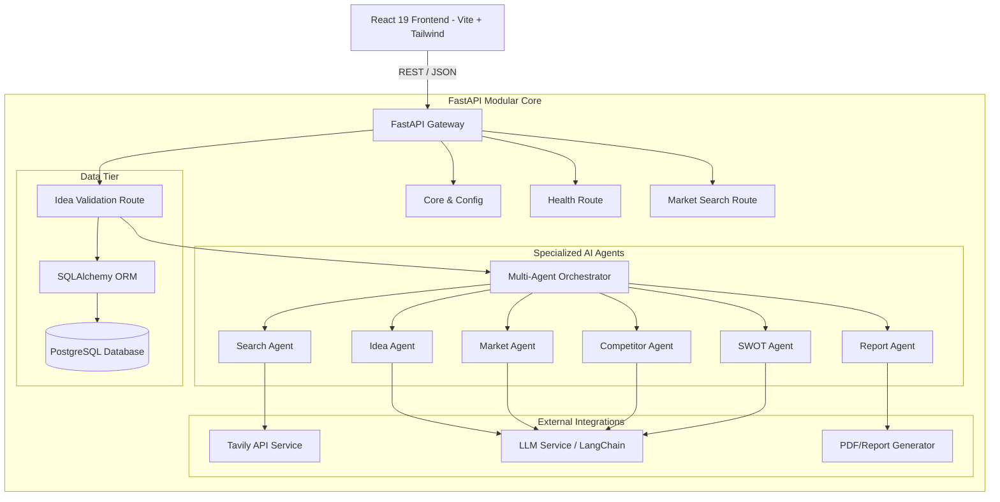

# AI-Based Startup Idea Validator with Market Analysis Assistance

[](https://github.com/organization/AI-Startup-Idea-Validator/actions)
[](https://github.com/organization/AI-Startup-Idea-Validator/actions)
[](LICENSE)
[](https://www.python.org/)
[](https://react.dev/)
[](https://fastapi.tiangolo.com/)

An enterprise-grade, multi-agent AI system designed to rigorously validate startup hypotheses, evaluate target markets, conduct automated competitive intelligence via live web searches, perform SWOT analyses, and generate executive-ready investor validation dossiers.

Developed as part of the **Infosys Springboard Virtual Internship 7.0**.

---

## 📑 Table of Contents

- [Overview](#overview)
- [System Architecture](#system-architecture)
- [Tech Stack](#tech-stack)
- [Multi-Agent Workflow](#multi-agent-workflow)
- [Repository Structure](#repository-structure)
- [Getting Started](#getting-started)
  - [Prerequisites](#prerequisites)
  - [Backend Setup](#backend-setup)
  - [Frontend Setup](#frontend-setup)
  - [Docker Setup](#docker-setup)
- [Milestone Roadmap](#milestone-roadmap)
- [Branching & Version Control Strategy](#branching--version-control-strategy)
- [Deployment Strategy](#deployment-strategy)
- [Documentation Index](#documentation-index)
- [License](#license)

---

## 🚀 Overview

Validating early-stage startup ideas usually requires hundreds of hours of manual research: market sizing, finding direct/indirect competitors, analyzing customer sentiment, identifying market risks, and synthesizing SWOT frameworks.

**AI-Based Startup Idea Validator** automates this lifecycle using collaborative autonomous AI agents:
1. **Idea Evaluation Agent**: Assesses problem-solution fit, value proposition, and innovation index.
2. **Search Agent (Tavily)**: Conducts live, low-latency market research and retrieves relevant industry data.
3. **Market Analysis Agent**: Evaluates TAM/SAM/SOM estimates, target demographics, and industry trends.
4. **Competitor Intelligence Agent**: Maps competitors, moat defensibility, and pricing matrices.
5. **SWOT Agent**: Synthesizes Strengths, Weaknesses, Opportunities, and Threats based on factual data.
6. **Report Generation Agent**: Compiles findings into downloadable executive PDF & Markdown validation briefs.

---

## 🏗️ System Architecture



---

## 💻 Tech Stack

### Frontend
- **Framework**: React 19 (Component-Based UI Architecture)
- **Bundler & Tooling**: Vite 6+
- **Styling**: Tailwind CSS
- **HTTP Client**: Axios (Centralized API Interceptors)
- **Routing**: React Router DOM (v7/v6)
- **Icons**: Lucide React

### Backend
- **Language**: Python 3.12+
- **API Framework**: FastAPI (Async ASGI)
- **Application Server**: Uvicorn
- **Data Validation & Settings**: Pydantic v2 & Pydantic Settings
- **ORM / Persistence**: SQLAlchemy 2.0 (PostgreSQL ready)
- **Environment Management**: python-dotenv

### DevOps & Infrastructure
- **Containerization**: Docker & Docker Compose
- **CI/CD**: GitHub Actions (Workflows for backend pytest and frontend lint/build)
- **Deployment**:
  - **Frontend**: Vercel
  - **Backend**: Render

---

## 🤖 Multi-Agent Workflow

| Agent | Responsibility | Output Artifact |
| :--- | :--- | :--- |
| **Search Agent** | Live web retrieval of recent industry news, market reports, and competitor data via Tavily API | Raw contextual search results |
| **Idea Agent** | Problem statement clarity, uniqueness assessment, and target customer personas | Idea scoring & feasibility matrix |
| **Market Agent** | Sector analysis, estimated market size (TAM/SAM/SOM), and growth trends | Market opportunity report |
| **Competitor Agent** | Identifies existing players, substitute solutions, and market differentiation | Competitor landscape & moat analysis |
| **SWOT Agent** | Generates a balanced 4-quadrant strategic SWOT matrix based on verified data | Structured SWOT evaluation |
| **Report Agent** | Assembles modular evaluations into a finalized, investor-ready validation dossier | Executive PDF & Markdown report |

---

## 📁 Repository Structure

```
AI-Startup-Idea-Validator/
├── .github/
│   └── workflows/
│       ├── backend.yml            # CI workflow for backend linting and testing
│       └── frontend.yml           # CI workflow for frontend building and testing
│
├── backend/
│   ├── app/
│   │   ├── api/
│   │   │   └── routes/
│   │   │       ├── health.py      # Health check endpoints
│   │   │       ├── idea.py        # Idea validation endpoints
│   │   │       └── search.py      # Search & market discovery endpoints
│   │   │
│   │   ├── agents/                # Multi-agent architecture definitions
│   │   │   ├── search_agent.py    # Tavily web search agent
│   │   │   ├── idea_agent.py      # Core idea validation agent
│   │   │   ├── market_agent.py    # Market sizing & dynamics agent
│   │   │   ├── competitor_agent.py# Competitive landscape agent
│   │   │   ├── swot_agent.py      # Strategic SWOT agent
│   │   │   └── report_agent.py    # PDF dossier synthesis agent
│   │   │
│   │   ├── core/
│   │   │   ├── config.py          # Centralized configuration & environment loader
│   │   │   └── logging.py         # Structured logging configuration
│   │   │
│   │   ├── models/                # SQLAlchemy database models
│   │   │   ├── idea.py            # Idea submission & analysis ORM model
│   │   │   └── search_result.py   # Search cache ORM model
│   │   │
│   │   ├── schemas/               # Pydantic v2 validation models
│   │   │   ├── idea_schema.py     # Request/Response schemas for startup ideas
│   │   │   └── response_schema.py # Universal envelope API responses
│   │   │
│   │   ├── services/              # External service wrappers
│   │   │   ├── tavily_service.py  # Tavily API client wrapper
│   │   │   └── llm_service.py     # LLM provider wrapper (OpenAI/Gemini/Anthropic)
│   │   │
│   │   ├── utils/                 # General helpers and text sanitizers
│   │   │   └── helpers.py
│   │   │
│   │   └── main.py                # FastAPI entry point & ASGI setup
│   │
│   ├── tests/                     # Unit and integration test suites
│   ├── requirements.txt           # Python dependencies
│   ├── .env.example               # Backend environment template
│   ├── .gitignore                 # Backend-specific ignore rules
│   └── README.md                  # Backend developer guide
│
├── frontend/
│   ├── public/                    # Static assets
│   ├── src/
│   │   ├── api/                   # Axios HTTP clients and API services
│   │   ├── assets/                # Images, brand marks, and media
│   │   ├── components/            # Reusable UI component library
│   │   ├── context/               # Global state / Context API providers
│   │   ├── hooks/                 # Custom React hooks
│   │   ├── layouts/               # Page layouts (Navbar, Sidebar, Footer)
│   │   ├── pages/                 # Route views (Home, Validator, Reports, 404)
│   │   ├── styles/                # Tailwind CSS stylesheets
│   │   ├── utils/                 # Utility functions and formatters
│   │   ├── App.jsx                # Root route registration
│   │   └── main.jsx               # React 19 entry point
│   │
│   ├── package.json               # NPM package manifest
│   ├── vite.config.js             # Vite 6 configuration
│   ├── .gitignore                 # Frontend-specific ignore rules
│   └── README.md                  # Frontend developer guide
│
├── docs/                          # Architecture & Milestone Documentation
│   ├── architecture.md            # Clean architecture & design specification
│   ├── api-flow.md                # API contract and data flow
│   ├── agent-design.md            # Multi-agent system architecture
│   ├── data-models.md             # Database schemas & ER diagrams
│   └── milestone-1.md             # Milestone 1 delivery report
│
├── docker-compose.yml             # Local multi-service orchestration
├── LICENSE                        # MIT License
├── .gitignore                     # Root repository ignore rules
└── README.md                      # Project master documentation
```

---

## ⚡ Getting Started

### Prerequisites
- **Python**: 3.12 or newer
- **Node.js**: v20 or newer (v24 LTS recommended)
- **Package Managers**: `pip` (Python) and `npm` (Node.js)
- **Docker** *(Optional)*: Docker Desktop for containerized deployment

---

### Backend Setup

1. **Navigate to the backend directory**:
   ```bash
   cd backend
   ```

2. **Create and activate a virtual environment**:
   ```bash
   # Windows (PowerShell)
   python -m venv .venv
   .venv\Scripts\Activate.ps1

   # macOS / Linux
   python3 -m venv .venv
   source .venv/bin/activate
   ```

3. **Install dependencies**:
   ```bash
   pip install -r requirements.txt
   ```

4. **Configure environment variables**:
   ```bash
   cp .env.example .env
   ```

5. **Run the FastAPI development server**:
   ```bash
   uvicorn app.main:app --reload --host 127.0.0.1 --port 8000
   ```

6. **Verify server execution**:
   - Interactive Swagger API Docs: [http://127.0.0.1:8000/docs](http://127.0.0.1:8000/docs)
   - Alternative Redoc: [http://127.0.0.1:8000/redoc](http://127.0.0.1:8000/redoc)
   - Health Check: [http://127.0.0.1:8000/api/v1/health](http://127.0.0.1:8000/api/v1/health)

---

### Frontend Setup

1. **Navigate to the frontend directory**:
   ```bash
   cd frontend
   ```

2. **Install node dependencies**:
   ```bash
   npm install
   ```

3. **Start the Vite development server**:
   ```bash
   npm run dev
   ```

4. **Access the application**:
   - Web Application: [http://localhost:5173](http://localhost:5173)

---

### Docker Setup

To launch the full stack (FastAPI Backend + React Frontend + PostgreSQL) with a single command:

```bash
docker-compose up --build
```

---

## 🎯 Milestone Roadmap

- [x] **Milestone 1**: Complete project skeleton, production architecture design, environment setups, and CI pipelines.
- [ ] **Milestone 2**: LLM provider integration, prompt engineering pipelines, and core idea evaluation service.
- [ ] **Milestone 3**: Tavily Search API integration, real-time web querying, and competitor intelligence ingestion.
- [ ] **Milestone 4**: Full multi-agent orchestration (Search, Market, Competitor, SWOT, Report agents).
- [ ] **Milestone 5**: PostgreSQL persistence, user authentication, and validation report history.
- [ ] **Milestone 6**: Interactive analytics dashboard, charts, and downloadable PDF report generation.
- [ ] **Milestone 7**: Production deployment (Frontend on Vercel, Backend on Render), integration testing, and documentation finalization.

---

## 🌿 Branching & Version Control Strategy

In adherence to industry standards, this repository maintains:
- `main`: **Production branch**. Always deployable, strictly protected. Accepts merges only via verified Pull Requests from `staging`.
- `staging`: **Development & Integration branch**. Aggregates features and verified fixes before release.
- Feature branches: Named using standard patterns (`feature/<feature-name>`, `bugfix/<fix-name>`, `docs/<doc-name>`).

---

## 🌐 Deployment Strategy

- **Frontend**: Configured for continuous automated deployment on **Vercel** via GitHub integration.
- **Backend**: Containerized ASGI service deployed on **Render** (Web Service with environment variable secret management).
- **Database**: Managed PostgreSQL instance hosted on Render / Supabase / Neon.

---

## 📚 Documentation Index

Detailed architectural blueprints are available in the [`docs/`](docs/) directory:
- [Clean Architecture & System Design](docs/architecture.md)
- [API Flow & Sequence Diagrams](docs/api-flow.md)
- [Multi-Agent Design Specification](docs/agent-design.md)
- [Database Schema & Data Models](docs/data-models.md)
- [Milestone 1 Status & Deliverables](docs/milestone-1.md)

---

## 📄 License

This project is licensed under the MIT License - see the [LICENSE](LICENSE) file for details.
