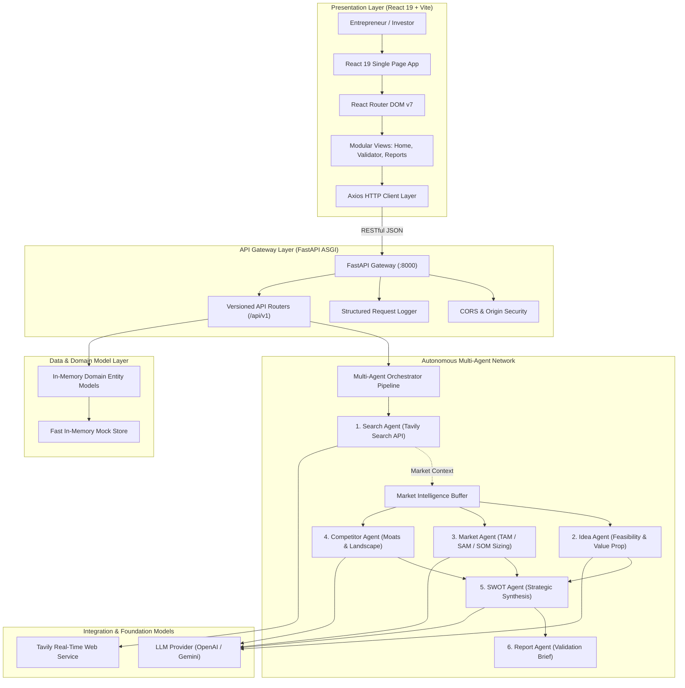

# AI-Based Startup Idea Validator with Market Analysis Assistance

<div align="center">


<p align="center">
  <strong>An Enterprise-Grade, Multi-Agent AI System for Startup Feasibility Scoring, Real-Time Market Intelligence, Competitor Moat Analysis, and Automated Investment Dossier Synthesis.</strong>
</p>

[Explore Documentation](docs/architecture.md) • [View API Flow](docs/api-flow.md) • [Agent Architecture](docs/agent-design.md) • [Data Models](docs/data-models.md) • [Milestone Report](docs/milestone-1.md)

</div>

---

## 📌 Executive Summary

Early-stage venture creation faces an existential hurdle: **over 90% of startups fail due to lack of market need**. Founders, accelerators, and venture evaluators spend weeks conducting fragmented manual market sizing, competitive landscape scraping, and subjective SWOT assessments.

The **AI-Based Startup Idea Validator** transforms this process into an automated, data-grounded workflow. Using a **specialized ensemble of autonomous AI agents**, the platform:
- **Single-Input Natural Language Interface:** Accepts a single startup description (e.g., *"I want to build an AI platform that helps students prepare for interviews."*) and automatically extracts core dimensions (problem, solution, audience, industry, model) via LLM.
- **Multi-Provider LLM Integration:** Powered by Google Gemini (Priority 1), OpenAI (Priority 2), and Groq (Priority 3) with intelligent fallback resilience.
- **Live Market Web Intelligence:** Retrieves live industry trends, competitive signals, and market demand using the **Tavily Search API**.
- **Market Sizing Projections:** Derives algorithmic **TAM, SAM, SOM**, and **CAGR** growth metrics tailored to the vertical.
- **Competitive Moat Analysis:** Maps direct incumbents, indirect substitutes, and sustainable defensive moats.
- **Strategic SWOT Matrix:** Synthesizes internal strengths and external threats into an objective 4-quadrant strategic matrix.
- **13-Section Consulting Dossier:** Formatted in top-tier management consulting style (McKinsey, BCG, Deloitte) with cards, clean typography, validation scoring, and zero chart clutter.

> **Note on Architecture & Deployment:** The project is deliberately designed to be **lightweight, modular, and self-contained**. It runs directly on your local machine using standard Python and Node.js in-memory without requiring Docker or any external database setup, making it immediately testable and reproducible for evaluations. Database persistence is planned for Milestone 5.

---

## 🏛️ System Architecture

The project is structured according to **Clean Architecture** and **Component-Driven Design**, decoupling presentation, business logic, agent orchestration, and domain models.



---

## 🤖 Multi-Agent Network Specification

| Agent Name | Primary Responsibility | Input Context | Generated Artifact |
| :--- | :--- | :--- | :--- |
| **Search Agent** | Formulates optimal search operators and queries Tavily API for live industry data. | Industry vertical, startup keywords | Verified articles, market snippets, competitor URLs |
| **Idea Agent** | Assesses foundational problem clarity, customer friction, and innovation index. | User submission, web context | Feasibility score (0–100), core value critique |
| **Market Agent** | Analyzes industry CAGR, demographic trends, and computes TAM/SAM/SOM. | Target audience, geographic focus | Quantified market size estimates, growth factors |
| **Competitor Agent** | Identifies existing market leaders, emergent startups, and defensive moats. | Product category, search snippets | Competitor profiles, feature comparison, moats |
| **SWOT Agent** | Cross-correlates multi-agent findings into an objective 4-quadrant strategic matrix. | Outputs of Idea, Market, & Competitor agents | Structured SWOT matrix (S, W, O, T) |
| **Report Agent** | Assembles structured data into executive summaries and compiles validation dossiers. | Consolidated JSON validation payload | Standardized Validation Dossier & Executive Brief |

---

## 💻 Technology Stack

### Frontend Architecture
- **Framework:** [React 19](https://react.dev/) (Component-Based UI Architecture)
- **Tooling & Bundler:** [Vite 6](https://vitejs.dev/) (Fast HMR and optimized production bundles)
- **Styling:** [Tailwind CSS 3.4](https://tailwindcss.com/) (Responsive, utility-first design system)
- **HTTP Client:** [Axios](https://axios-http.com/) (Configured with request/response interceptors)
- **Routing:** [React Router DOM](https://reactrouter.com/) (Declarative client-side routing)
- **Icons:** [Lucide React](https://lucide.dev/) (Modern iconography)

### Backend Architecture
- **Runtime:** [Python 3.12+](https://www.python.org/)
- **Web Framework:** [FastAPI](https://fastapi.tiangolo.com/) (High-performance ASGI framework)
- **Application Server:** [Uvicorn](https://www.uvicorn.org/) (High-concurrency ASGI server)
- **Data Validation:** [Pydantic v2](https://docs.pydantic.dev/) & `pydantic-settings`
- **Domain Modeling:** Clean in-memory Python dataclasses (Zero database configuration required)
- **Environment Management:** `python-dotenv`

### Quality Assurance & CI/CD
- **Automated Testing:** `pytest` & Python `unittest` test suites
- **Continuous Integration:** GitHub Actions (`.github/workflows/backend.yml` & `frontend.yml`)
- **Deployment Targets:**
  - **Frontend:** Vercel (Edge CDN Network)
  - **Backend:** Render (Web Service ASGI Container)

---

## 📁 Repository Directory Structure

```
AI-Startup-Idea-Validator/
├── .github/
│   └── workflows/
│       ├── backend.yml            # CI: Backend linting, compileall, and test suite
│       └── frontend.yml           # CI: Node.js setup, dependencies, and Vite build
│
├── backend/
│   ├── app/
│   │   ├── api/
│   │   │   ├── routes/
│   │   │   │   ├── __init__.py    # Router exports
│   │   │   │   ├── health.py      # Health probe (/api/v1/health/)
│   │   │   │   ├── idea.py        # Idea validation endpoints (/api/v1/idea/*)
│   │   │   │   └── search.py      # Market search endpoints (/api/v1/search/*)
│   │   │   └── __init__.py
│   │   │
│   │   ├── agents/                # Autonomous AI Multi-Agent Network
│   │   │   ├── __init__.py
│   │   │   ├── search_agent.py    # Tavily web intelligence agent
│   │   │   ├── idea_agent.py      # Feasibility & value proposition agent
│   │   │   ├── market_agent.py    # TAM / SAM / SOM market sizing agent
│   │   │   ├── competitor_agent.py# Competitive landscape & moat agent
│   │   │   ├── swot_agent.py      # Strategic SWOT matrix agent
│   │   │   └── report_agent.py    # Validation dossier & executive brief agent
│   │   │
│   │   ├── core/
│   │   │   ├── __init__.py
│   │   │   ├── config.py          # Centralized Pydantic Settings & CORS
│   │   │   └── logging.py         # Standardized structured application logger
│   │   │
│   │   ├── models/                # Domain Entity Models (In-Memory)
│   │   │   ├── __init__.py        # Domain model exports
│   │   │   ├── idea.py            # StartupIdea & ValidationReport entities
│   │   │   └── search_result.py   # SearchResultCache domain entity
│   │   │
│   │   ├── schemas/               # Pydantic v2 Request/Response Data Contracts
│   │   │   ├── __init__.py
│   │   │   ├── idea_schema.py     # Request schemas & SWOT definitions
│   │   │   └── response_schema.py # Universal ApiResponse envelope
│   │   │
│   │   ├── services/              # Third-Party API Adapters
│   │   │   ├── __init__.py
│   │   │   ├── tavily_service.py  # Tavily Search API client wrapper
│   │   │   └── llm_service.py     # LLM provider wrapper (OpenAI / Gemini)
│   │   │
│   │   ├── utils/
│   │   │   ├── __init__.py
│   │   │   └── helpers.py         # Sanitizers, formatting, and ID generators
│   │   │
│   │   └── main.py                # FastAPI application entrypoint & middleware
│   │
│   ├── tests/
│   │   ├── __init__.py
│   │   └── test_health.py         # Unit testing and route verification suite
│   │
│   ├── requirements.txt           # Lean Python dependencies
│   ├── .env.example               # Backend environment variables template
│   ├── .gitignore                 # Python virtualenv & bytecode ignore rules
│   └── README.md                  # Backend developer guide
│
├── frontend/
│   ├── public/
│   │   └── favicon.svg            # Branded application favicon
│   │
│   ├── src/
│   │   ├── api/
│   │   │   ├── client.js          # Centralized Axios client & interceptors
│   │   │   └── ideaApi.js         # Domain API request methods
│   │   │
│   │   ├── assets/                # Logos and application graphics
│   │   │   └── logo.svg
│   │   │
│   │   ├── components/
│   │   │   └── common/            # Atomic UI primitives
│   │   │       ├── Header.jsx     # Navigation bar with route highlight
│   │   │       ├── Footer.jsx     # Project footer
│   │   │       ├── Button.jsx     # Reusable button with variants
│   │   │       └── Card.jsx       # Standard content container
│   │   │
│   │   ├── context/
│   │   │   └── AppContext.jsx     # Global application state provider
│   │   │
│   │   ├── hooks/
│   │   │   └── useIdeaValidation.js # Custom hook for validation state
│   │   │
│   │   ├── layouts/
│   │   │   └── MainLayout.jsx     # Top-level page layout container
│   │   │
│   │   ├── pages/
│   │   │   ├── HomePage.jsx       # Landing page with core overview & quick start
│   │   │   ├── ValidatorPage.jsx  # Single-input idea validator & 13-section consulting report
│   │   │   ├── AboutPage.jsx      # Architecture, internship details, and team info
│   │   │   └── NotFoundPage.jsx   # 404 error page
│   │   │
│   │   ├── styles/
│   │   │   └── index.css          # Tailwind CSS directives
│   │   │
│   │   ├── utils/
│   │   │   └── constants.js       # Industry domains, enum values, metadata
│   │   │
│   │   ├── App.jsx                # React Router DOM route hierarchy
│   │   └── main.jsx               # React 19 entrypoint
│   │
│   ├── index.html                 # Single page application HTML shell
│   ├── package.json               # NPM package manifest
│   ├── vite.config.js             # Vite build & reverse-proxy configuration
│   ├── tailwind.config.js         # Tailwind design system configuration
│   ├── postcss.config.js          # PostCSS configuration
│   ├── .gitignore                 # Node & build artifact ignore rules
│   └── README.md                  # Frontend developer guide
│
├── docs/                          # Comprehensive Architectural Documentation
│   ├── architecture.md            # Clean Architecture specification
│   ├── api-flow.md                # REST API schemas & sequence diagrams
│   ├── agent-design.md            # Multi-agent coordination blueprint
│   ├── data-models.md             # Domain entities & future schema contracts
│   └── milestone-1.md             # Milestone 1 delivery report
│
├── docker-compose.yml             # Local multi-service specification
├── LICENSE                        # Open-source MIT License
├── .gitignore                     # Repository-level ignore rules
└── README.md                      # Master project README
```

---

## ⚡ Quick Start & Local Setup

### Prerequisites
- **Python**: 3.12 or newer
- **Node.js**: v20 or newer (v24 LTS recommended)
- **Database/Docker**: *None required.* The application runs completely in-memory with zero external service dependencies.

---

### 1. Backend Setup

```bash
# 1. Navigate to the backend directory
cd backend

# 2. Create and activate a clean virtual environment
# Windows (PowerShell):
python -m venv .venv
.venv\Scripts\Activate.ps1

# macOS / Linux:
python3 -m venv .venv
source .venv/bin/activate

# 3. Install backend dependencies
pip install -r requirements.txt

# 4. Initialize environment variables
cp .env.example .env

# 5. Start the FastAPI development server
uvicorn app.main:app --reload --host 127.0.0.1 --port 8000
```

#### API Explorer & Documentation:
- **Interactive Swagger UI**: [http://127.0.0.1:8000/docs](http://127.0.0.1:8000/docs)
- **ReDoc Documentation**: [http://127.0.0.1:8000/redoc](http://127.0.0.1:8000/redoc)
- **Live Health Probe**: [http://127.0.0.1:8000/api/v1/health/](http://127.0.0.1:8000/api/v1/health/)

---

### 2. Frontend Setup

```bash
# 1. Navigate to the frontend directory
cd frontend

# 2. Install dependencies
npm install

# 3. Start the Vite development server
npm run dev
```

- **Web Application URL**: [http://localhost:5173](http://localhost:5173)

---

## 📡 API Endpoints & Contract Overview

All endpoints return responses encapsulated in a standardized `ApiResponse` envelope:

| Method | Endpoint | Description | Status |
| :--- | :--- | :--- | :--- |
| `GET` | `/` | Root server status and API index | Active |
| `GET` | `/api/v1/health/` | Liveness probe and environment diagnostics | Active |
| `POST` | `/api/v1/idea/validate` | Submits idea for multi-agent evaluation | Active (Mock Contract) |
| `GET` | `/api/v1/idea/{idea_id}` | Retrieves validation report by unique ID | Active (Mock Contract) |
| `POST` | `/api/v1/search/market` | Runs real-time web search for market insights | Active (Mock Contract) |

### Sample Validation Request:
```bash
curl -X POST "http://127.0.0.1:8000/api/v1/idea/validate" \
     -H "Content-Type: application/json" \
     -d '{
       "title": "EcoLogix",
       "description": "AI-powered IoT route optimization and cold-chain monitoring for perishable transport.",
       "target_market": "Logistics & Supply Chain",
       "target_audience": "Freight Fleet Managers",
       "estimated_budget": "$50,000",
       "monetization_model": "Monthly B2B SaaS"
     }'
```

### Sample Validation Response:
```json
{
  "success": true,
  "data": {
    "id": "idea_8f4b12a9",
    "title": "EcoLogix",
    "status": "completed",
    "scores": {
      "overall": 82.0,
      "feasibility": 85.0,
      "market_demand": 80.0,
      "uniqueness": 81.0
    },
    "swot": {
      "strengths": [
        "Strong initial focus on Logistics & Supply Chain",
        "Clear value proposition defined"
      ],
      "weaknesses": [
        "High initial customer acquisition costs",
        "Requires early strategic partnerships"
      ],
      "opportunities": [
        "Expanding addressable market through AI automation"
      ],
      "threats": [
        "Rapidly evolving competitive landscape"
      ]
    },
    "summary": "Preliminary validation for 'EcoLogix': Concept demonstrates viable product-market fit indicators.",
    "competitors": [
      "Competitor One (Market Leader)",
      "Competitor Two (Emerging Challenger)"
    ],
    "market_sizing": {
      "tam": "$12.8B global sector size",
      "sam": "$2.5B serviceable market",
      "som": "$180M initial beachhead"
    }
  },
  "message": "Idea validation completed successfully (Milestone 1 skeleton)",
  "errors": null
}
```

---

## 🧪 Testing & Verification

Run the automated test suite to verify route registration and API controller contracts:

```bash
# Execute test suite directly
python backend/tests/test_health.py
```

Expected output:
```text
test_app_routes_registration: ok
test_get_idea_validation_by_id: ok
test_health_check_controller: ok
test_idea_validation_controller: ok
test_market_search_controller: ok

----------------------------------------------------------------------
Ran 5 tests in 0.008s
OK
```

---

## 🌿 Version Control & Git Strategy

Following enterprise Git hygiene:
- **`main`**: **Production branch**. Strictly protected. Contains verified, deployable code.
- **`staging`**: **Integration & Development branch**. Used for active feature verification prior to release merges into `main`.
- **Feature Branches**: Formatted as `feature/<feature-description>`.

---

## 📚 Documentation Reference

For in-depth architectural and technical blueprints, consult the documentation directory:
- 🏛️ [Clean Architecture Specification](docs/architecture.md)
- 🔄 [API Flow & Sequence Diagrams](docs/api-flow.md)
- 🤖 [Multi-Agent Design Blueprint](docs/agent-design.md)
- 🗄️ [Data Models & Schema Contracts](docs/data-models.md)
- 📋 [Milestone 1 Completion Report](docs/milestone-1.md)

---

## 👥 Authors & Project Attribution

- **Developer:** [Lakshya Singhal](https://github.com/lakshyasinghal08)
- **Repository:** [AI-Startup-Idea-Validator](https://github.com/lakshyasinghal08/AI-Startup-Idea-Validator)
- **Program:** Infosys Springboard Virtual Internship 7.0

---

## 📄 License

This project is licensed under the **MIT License** — see the [LICENSE](LICENSE) file for complete details.
