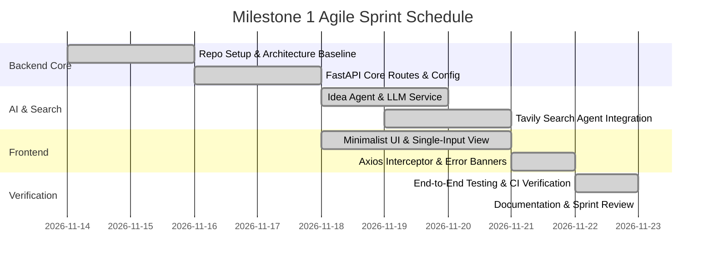

# Agile Sprint Plan — Milestone 1

**Project:** AI-Based Startup Idea Validator with Market Analysis Assistance  
**Program:** Infosys Springboard Virtual Internship 7.0  
**Sprint Cycle:** Sprint 1 (Milestone 1 — Architecture, Core Agents & Real-Time Search)  
**Timeline:** November 14, 2026 – November 23, 2026  
**Methodology:** Agile Scrum (1-Week Iteration with Daily Standups)  

---

## 1. Sprint Objective

The primary objective of Sprint 1 (Milestone 1) is to establish the foundational architecture, clean decoupled client-server structure, LLM-powered idea extraction, and live real-time market search intelligence without relying on persistent databases, fake demo data, or premature complex AI workflows.

### Definition of Done (DoD)
- Clean, minimal, professional frontend with ONE textarea, ONE button, and ONE comprehensive report view.
- FastAPI backend with modular routers (`/health`, `/idea`, `/search`) and centralized Pydantic settings.
- Real LLM integration (Groq Cloud / Google Gemini) for structured startup parameter extraction.
- Real Tavily AI Search API integration returning genuine web market intelligence snippets.
- Strict error handling: HTTP 400 with meaningful JSON when API keys are unconfigured (no fallback/fake data).
- Automated CI/CD pipelines passing lint and unit tests.
- Comprehensive architectural, research, and agile tracking documentation.

---

## 2. Team Roster & Roles

| Team Member | Role | Core Responsibility Area |
| :--- | :--- | :--- |
| **Lakshya Singhal** | Project Lead & Full Stack Architect | System Architecture, Git Flow Coordination, LLM & Tavily Integration, DevOps CI/CD |
| **Poojitha B** | Senior AI & Backend Engineer | Idea Extraction Agent, Prompt Engineering, Pydantic Schemas & Settings Management |
| **Sahil** | Senior Backend & Search Engineer | Search Agent Development, Tavily API Client, API Route Handlers & Integration Testing |
| **Supritha** | Senior Frontend & UI/UX Engineer | React 19 Client, Responsive Validator Interface, State Machine & Error Interception |

---

## 3. Sprint Backlog & Epics

### Epic 1: Repository Setup & Backend Core Architecture
- **Sprint Goal:** Establish clean FastAPI application factory, Pydantic settings, and health check monitoring.
- **Assigned To:** Lakshya, Sahil
- **Deliverables:** `backend/app/main.py`, `backend/app/core/config.py`, `backend/app/api/routes/health.py`

### Epic 2: LLM Idea Extraction Engine
- **Sprint Goal:** Build `IdeaAgent` and `LLMService` supporting Groq and Gemini with strict schema enforcement.
- **Assigned To:** Poojitha, Lakshya
- **Deliverables:** `backend/app/agents/idea_agent.py`, `backend/app/services/llm_service.py`

### Epic 3: Real-Time Market Search Intelligence
- **Sprint Goal:** Implement `SearchAgent` and `TavilySearchService` for live web intelligence without fabricated fallbacks.
- **Assigned To:** Sahil, Poojitha
- **Deliverables:** `backend/app/agents/search_agent.py`, `backend/app/services/tavily_service.py`, `backend/app/api/routes/search.py`

### Epic 4: Clean, Minimalist Presentation Layer
- **Sprint Goal:** Build responsive, professional UI with ONE prompt input, ONE action button, progressive loading state, and clear error banners.
- **Assigned To:** Supritha, Lakshya
- **Deliverables:** `frontend/src/pages/ValidatorPage.jsx`, `frontend/src/api/client.js`, `frontend/src/api/ideaApi.js`

### Epic 5: Quality Assurance, Automated CI & Technical Documentation
- **Sprint Goal:** Author research notes, architecture documentation, unit test suites, and GitHub Actions CI pipelines.
- **Assigned To:** All Team Members
- **Deliverables:** `docs/`, `agile/`, `backend/tests/`, `.github/workflows/`

---

## 4. Sprint Schedule & Milestones

---

## 5. Sprint Retrospective

* **What Went Well:**
  * Clean transition from initial over-engineered drafts to a crisp, minimal architecture.
  * Real integration of Groq Cloud LPU inference and Tavily AI Search operating seamlessly.
  * Rapid unit test suite execution (< 5 seconds) ensuring continuous reliability in CI.
* **Challenges Overcome:**
  * Strict removal of fabricated demo data and placeholder fallbacks to ensure genuine validation.
  * Harmonization of environment variables across local development and GitHub Actions runners.
* **Action Items for Milestone 2:**
  * Expand agent network with Market Sizing Agent, Competitor Moat Agent, and SWOT Agent.
  * Connect persistent PostgreSQL database with Alembic migration tracking.
