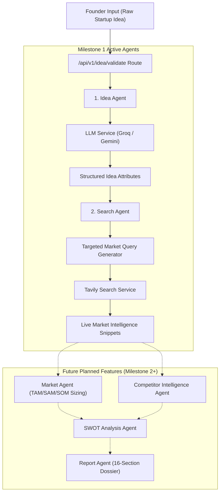

# Multi-Agent System Design Specification

**Project:** AI-Based Startup Idea Validator with Market Analysis Assistance  
**Program:** Infosys Springboard Virtual Internship 7.0 — Milestone 1  
**Scope:** Milestone 1 Core Agents & Future Planned System Architecture  

---

## 1. Overview

The **AI Startup Idea Validator** uses specialized AI agents with strict boundaries and single responsibilities. Instead of a monolithic prompt, each agent operates over typed data schemas, ensuring verifiable data lineage, prompt isolation, and deterministic execution.

---

## 2. Milestone 1 Active Agent Pipeline



---

## 3. Milestone 1 Core Agents & Services

### 3.1 Idea Agent (`app/agents/idea_agent.py`)
* **Core Responsibility**: Deconstructs raw, unstructured founder idea text into structured, standardized venture attributes.
* **LLM Engine**: Powered by `LLMService` (Groq LPU inference with fallback to Google Gemini).
* **Input**: Unstructured string (e.g. `"I want to build an AI platform that helps students prepare for interviews"`).
* **Output Schema**:
  ```json
  {
    "startup_name": "Working title or brand name",
    "industry": "Primary industry vertical (e.g. EdTech & Career Services)",
    "problem_statement": "Core pain point identified",
    "proposed_solution": "Description of the automated solution",
    "target_customers": "Primary demographic or enterprise segment",
    "business_model": "Monetization structure (e.g. B2C Freemium / B2B SaaS)",
    "value_proposition": "Core differentiator and value proposition"
  }
  ```
* **Error Behavior**: If no valid API key is configured (`GROQ_API_KEY` or `GEMINI_API_KEY`), the agent halts execution and returns a descriptive HTTP 400 error. It strictly forbids returning placeholder or fabricated mock data.

### 3.2 Search Agent (`app/agents/search_agent.py`)
* **Core Responsibility**: Transforms extracted startup attributes into targeted, multi-angle search queries and retrieves real-world market intelligence via Tavily.
* **Search Engine**: Direct integration with Tavily AI Search API (`https://api.tavily.com/search`).
* **Query Generation Strategy**:
  Generates 5 distinct search vectors based on extracted context:
  1. `"{startup_name}" {industry} {problem} market trends industry developments`
  2. `"{startup_name}" {industry} {problem} market demand growth opportunities`
  3. `"{startup_name}" {industry} {problem} competitors competing products alternative solutions`
  4. `"{startup_name}" {industry} {problem} customer problems pain points unmet needs`
  5. `"{startup_name}" {industry} {problem} industry gaps emerging opportunities`
* **Output**:
  Deduplicated list of real-world search items:
  ```json
  {
    "title": "Article or Competitor Headline",
    "url": "https://source-url.com",
    "content": "Pre-cleaned, high-signal contextual snippet from the live web",
    "score": 0.89
  }
  ```
* **Error Behavior**: When `TAVILY_API_KEY` is missing or invalid, the agent halts and surfaces an immediate HTTP 400 error. It does not generate synthetic or fake search results.

---

## 4. Foundation Services

### 4.1 LLM Service (`app/services/llm_service.py`)
* Provides unified execution across foundation models:
  * **Groq Cloud** (`llama-3.3-70b-versatile`, `qwen/qwen3.8-27b`, `openai/gpt-oss-120b`).
  * **Google Gemini** (`gemini-2.0-flash` / `gemini-1.5-flash`).
* Guarantees strict JSON schema formatting.
* Strictly rejects unauthenticated requests with `LLMConfigurationError`.

### 4.2 Tavily Service (`app/services/tavily_service.py`)
* Connects to the official Tavily REST API with configurable search depth (`basic` or `advanced`).
* Validates URL syntax and filters out low-relevance results.
* Strictly rejects unauthenticated requests with `TavilyConfigurationError`.

---

## 5. Future Planned Features (Milestone 2 and Beyond)

The following agents represent future extensions that will build upon Milestone 1's structured outputs:

### 5.1 Market Agent (`market_agent.py`)
* **Planned Responsibility**: Sizing the market using top-down industry databases and bottom-up arithmetic (TAM, SAM, SOM calculations and CAGR projections).

### 5.2 Competitor Agent (`competitor_agent.py`)
* **Planned Responsibility**: Mapping competitor landscape, categorizing direct vs. indirect competitors, identifying incumbent vulnerabilities, and scoring competitive moats.

### 5.3 SWOT Agent (`swot_agent.py`)
* **Planned Responsibility**: Synthesizing a 4-quadrant SWOT matrix (Strengths, Weaknesses, Opportunities, Threats) by cross-referencing internal idea feasibility against live market threats.

### 5.4 Report Agent (`report_agent.py`)
* **Planned Responsibility**: Aggregating all multi-agent findings into a 16-section management consulting brief with automated executive summary and PDF export.
