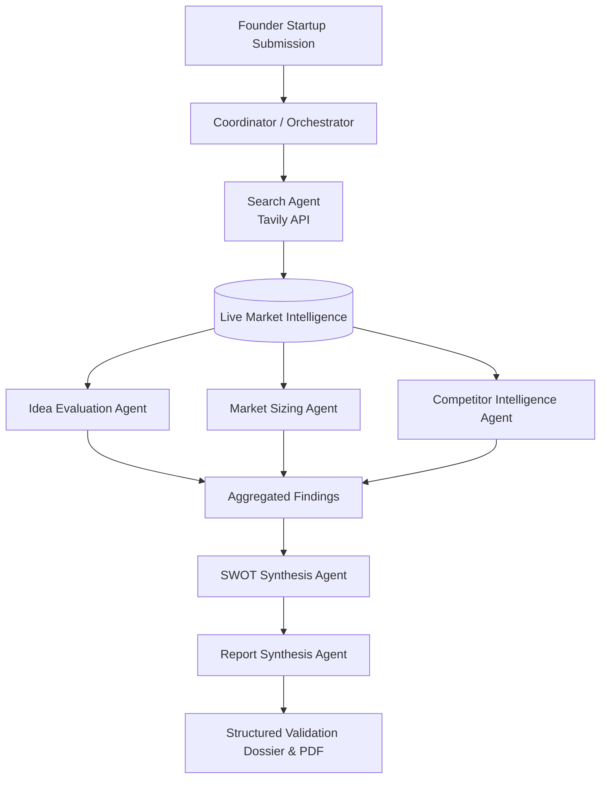

# Multi-Agent System Design Specification

## 1. Overview
The **AI Startup Idea Validator** utilizes an ensemble of specialized, autonomous AI agents. Rather than relying on a single monolithic prompt, each agent is assigned a single responsibility and operates over verified data structures.

---

## 2. Agent Orchestration Architecture

---

## 3. Agent Responsibilities & Prompt Boundaries

### 3.1 Idea Agent (`idea_agent.py`)
- **Primary Function**: Extracts structured startup attributes (problem, solution, audience, industry vertical, business model) from raw idea text and assesses core problem-solution fit.
- **Inputs**: User's original idea submission.
- **Outputs**: Structured venture attributes, feasibility score (0-100), core value proposition summary.

### 3.2 Search Agent (`search_agent.py`)
- **Primary Function**: Discovers real-time market data, existing competitors, and industry trends via the Tavily Search API.
- **Inputs**: Extracted keywords, industry sector, target audience.
- **Outputs**: Deduplicated list of domain articles, competitor URLs, and live market intelligence snippets.

### 3.3 Market Agent (`market_agent.py`)
- **Primary Function**: Estimates Total Addressable Market (TAM), Serviceable Available Market (SAM), and Serviceable Obtainable Market (SOM), plus regulatory and market trends.
- **Inputs**: Industry classification, geography, target customer segments, live search snippets.
- **Outputs**: Market size figures, CAGR projections, growth drivers, qualitative demand insights.

### 3.4 Competitor Agent (`competitor_agent.py`)
- **Primary Function**: Identifies direct and indirect competitors, competitive moats, and differentiation vectors.
- **Inputs**: Search results, product categories.
- **Outputs**: Competitor profiles (name, direct/indirect competitors, vulnerabilities, defensive moats).

### 3.5 SWOT Agent (`swot_agent.py`)
- **Primary Function**: Compiles an objective, evidence-based SWOT matrix by synthesizing outputs from the Idea, Market, and Competitor agents.
- **Inputs**: Outputs from IdeaAgent, MarketAgent, and CompetitorAgent.
- **Outputs**: 4-quadrant SWOT breakdown (Strengths, Weaknesses, Opportunities, Threats).

### 3.6 Report Agent (`report_agent.py`)
- **Primary Function**: Formats all multi-agent findings into a 16-section management consulting brief (McKinsey/BCG style).
- **Inputs**: Consolidated findings from all upstream agents.
- **Outputs**: 16-section consulting dossier with overall validation score and strategic conclusion.

---

## 4. Execution Strategies (Sequential vs Parallel)
1. **Phase 1 (Data Retrieval)**: `SearchAgent` runs first to establish ground-truth context from live web queries.
2. **Phase 2 (Concurrent Analysis)**: `IdeaAgent`, `MarketAgent`, and `CompetitorAgent` execute concurrently via `asyncio.gather()`.
3. **Phase 3 (Strategic Synthesis)**: `SWOTAgent` processes combined results.
4. **Phase 4 (Packaging)**: `ReportAgent` creates the user-facing report.
