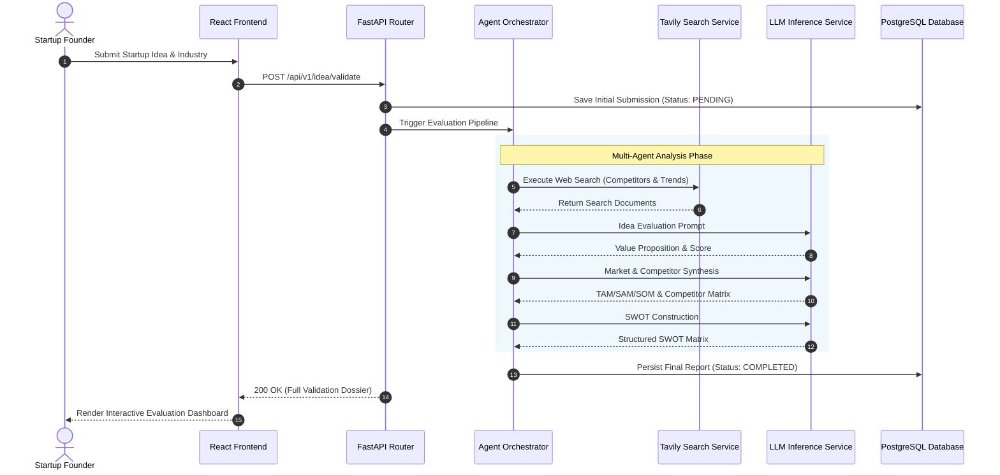

# API Flow and Contract Specifications

## 1. Overview
This document specifies the RESTful API communication protocol between the React 19 Frontend and the FastAPI Backend service for the Startup Idea Validator.

Base URL: `/api/v1`

---

## 2. API Endpoints Summary

| Method | Endpoint | Description | Status |
| :--- | :--- | :--- | :--- |
| `GET` | `/api/v1/health/` | Service health status and timestamp | Milestone 1 (Initialized) |
| `POST` | `/api/v1/idea/validate` | Submit idea for multi-agent validation | Milestone 1 (Placeholder) |
| `GET` | `/api/v1/idea/{idea_id}` | Retrieve past idea validation dossier | Milestone 1 (Placeholder) |
| `POST` | `/api/v1/search/market` | Trigger direct market search query | Milestone 1 (Placeholder) |

---

## 3. Request-Response Sequence



---

## 4. API Request & Response Schemas

### 4.1 Health Check Endpoint
- **Endpoint**: `GET /api/v1/health/`
- **Response**:
```json
{
  "status": "healthy",
  "app_name": "AI Startup Idea Validator",
  "environment": "development",
  "version": "1.0.0",
  "timestamp": "2026-11-14T12:00:00Z"
}
```

### 4.2 Validate Idea Endpoint
- **Endpoint**: `POST /api/v1/idea/validate`
- **Request Body**:
```json
{
  "title": "EcoLogix - Autonomous Cold Chain Logistics",
  "description": "AI-powered IoT route optimization and temperature monitoring for perishables.",
  "target_market": "Logistics & Supply Chain",
  "target_audience": "B2B Pharmaceutical & Food Distributors",
  "estimated_budget": "$50,000",
  "monetization_model": "SaaS Subscription + Hardware Lease"
}
```
- **Response Envelope**:
```json
{
  "success": true,
  "data": {
    "id": "idea_98765",
    "status": "completed",
    "scores": {
      "overall": 84,
      "feasibility": 82,
      "market_demand": 88,
      "uniqueness": 79
    },
    "swot": {
      "strengths": ["Proprietary algorithm", "High customer switching cost"],
      "weaknesses": ["Hardware dependency"],
      "opportunities": ["Regulatory ESG mandates"],
      "threats": ["Incumbent carrier pricing power"]
    }
  },
  "message": "Idea validation completed successfully",
  "errors": null
}
```

---

## 5. Error Handling Protocol
All errors return standardized HTTP status codes along with a structured response payload:
```json
{
  "success": false,
  "data": null,
  "message": "Resource not found or validation failure",
  "errors": [
    {
      "field": "description",
      "message": "Description must contain at least 20 characters."
    }
  ]
}
```
