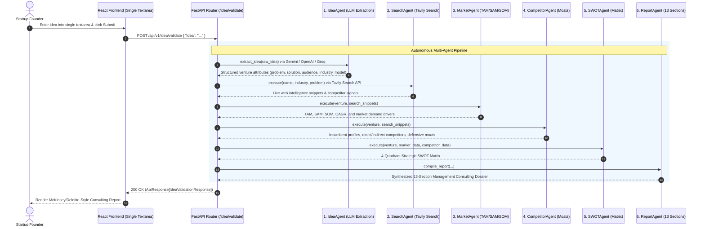

# API Flow and Contract Specifications

## 1. Overview
This document specifies the RESTful API communication protocol between the React 19 Frontend and the FastAPI Backend service for the Startup Idea Validator.

Base URL: `/api/v1`

---

## 2. API Endpoints Summary

| Method | Endpoint | Description | Status |
| :--- | :--- | :--- | :--- |
| `GET` | `/api/v1/health/` | Service health status, environment, and timestamp | Complete |
| `POST` | `/api/v1/idea/validate` | Submit idea for multi-agent validation & 13-section report | Complete |
| `GET` | `/api/v1/idea/{idea_id}` | Retrieve past idea validation consulting dossier | Complete (In-Memory) |
| `POST` | `/api/v1/search/market` | Trigger direct market search query via Tavily | Complete |

---

## 3. Request-Response Sequence



---

## 4. API Request & Response Schemas

### 4.1 Health Check Endpoint
- **Endpoint**: `GET /api/v1/health/`
- **Response**:
```json
{
  "status": "healthy",
  "app_name": "AI Startup Idea Validator",
  "environment": "development",
  "version": "1.0.0",
  "timestamp": "2026-11-19T21:30:00Z"
}
```

### 4.2 Validate Idea Endpoint (Single Input UX)
- **Endpoint**: `POST /api/v1/idea/validate`
- **Request Body**:
```json
{
  "idea": "I want to build an AI platform that helps students prepare for interviews."
}
```
*(Also supports optional composite fields `title`, `description`, `target_market` for backward compatibility).*

- **Response Envelope**:
```json
{
  "success": true,
  "data": {
    "id": "idea_e3f89a1b",
    "title": "AI Student Interview Preparation Platform",
    "status": "completed",
    "scores": {
      "overall": 82.8,
      "feasibility": 85.0,
      "market_demand": 82.0,
      "uniqueness": 81.0
    },
    "executive_summary": "Executive Validation Dossier: Demonstrates solid market fundamentals and addressable competitive moats...",
    "idea_overview": "An automated workflow platform serving high-growth EdTech & Career Tech segments...",
    "problem_statement": "Students lack access to affordable, realistic technical and behavioral mock interview feedback...",
    "proposed_solution": "An intelligent simulator providing real-time evaluation, domain-specific questions, and tailored coaching...",
    "target_customers": "College students, boot camp graduates, career switchers, and university placement teams...",
    "market_analysis": {
      "tam": "$8.5B Global EdTech / Career Market",
      "sam": "$1.9B Target Higher Ed & Graduate Segment",
      "som": "$140M Realistic Beachhead",
      "cagr": "15.8% CAGR",
      "demand_drivers": "Accelerating migration toward remote hiring and AI preparation tooling."
    },
    "competitor_analysis": {
      "direct_competitors": [
        {"name": "Pramp / Exponent", "vulnerability": "High hourly human coaching rates"},
        {"name": "LeetCode / HackerRank", "vulnerability": "Code focus only, lacks behavioral feedback"}
      ],
      "indirect_competitors": ["Informal peer practice", "Career center advisors"],
      "defensive_moats": ["Proprietary candidate outcome telemetry and institution LMS integrations"]
    },
    "swot_analysis": {
      "strengths": ["Clear value proposition", "Favorable freemium unit economics", "Automated delivery"],
      "weaknesses": ["Early brand obscurity", "Initial distribution dependency"],
      "opportunities": ["Global university cohort licensing", "Direct applicant tracking system integrations"],
      "threats": ["Incumbent bundling", "Model provider price shifts"]
    },
    "business_opportunities": [
      "Beachhead expansion via viral student referral loops",
      "University career services institutional multi-seat licensing"
    ],
    "potential_risks": [
      "Customer acquisition friction without organic viral loops",
      "Incumbent feature additions"
    ],
    "recommendations": [
      "Phase 1: Conduct 25 student discovery interviews",
      "Phase 2: Launch functional MVP for behavioral interviews",
      "Phase 3: Secure 3 university career center pilot partnerships"
    ],
    "overall_validation_score": 82.8,
    "final_conclusion": "Strategic Verdict: Highly Viable with defined execution milestones."
  },
  "message": "Idea validated successfully via multi-agent pipeline",
  "errors": null
}
```

---

## 5. Error Handling Protocol
All errors return standardized HTTP status codes along with a structured response payload:
```json
{
  "success": false,
  "data": null,
  "message": "Validation failure or missing required fields",
  "errors": [
    {
      "field": "idea",
      "message": "Startup idea description or title must be provided."
    }
  ]
}
```
