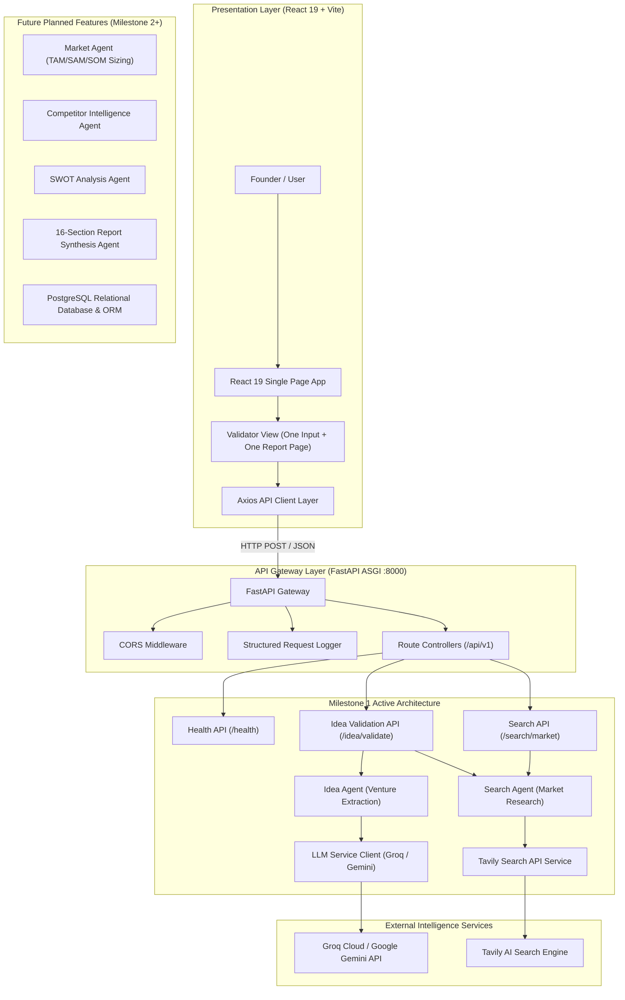

# Architecture Design Specification

**Project:** AI-Based Startup Idea Validator with Market Analysis Assistance  
**Program:** Infosys Springboard Virtual Internship 7.0 — Milestone 1  
**Status:** Milestone 1 Architecture Baseline  

---

## 1. System Overview

The **AI-Based Startup Idea Validator with Market Analysis Assistance** is an enterprise-grade, decoupled client-server application adhering to Clean Architecture principles. It enables early-stage founders to submit raw startup concepts, extracts structured venture dimensions using foundation Large Language Models (LLMs), and queries real-time market intelligence via the Tavily Search API.

---

## 2. Milestone 1 System Architecture Diagram

---

## 3. Active Milestone 1 Component Architecture

### 3.1 Presentation Layer (Frontend)
* **Single Responsiveness**: A clean, single-purpose interface consisting of ONE prompt input textarea, ONE submit action button, interactive progress indicators, and ONE comprehensive validation report page.
* **API Client Abstraction**: Frontend calls pass through `src/api/client.js` with unified error interception that renders exact backend HTTP error messages (e.g. `GROQ_API_KEY not configured` or `TAVILY_API_KEY not configured`).

### 3.2 API Gateway Layer (FastAPI)
* **High-Performance ASGI**: FastAPI application configured with CORS origin security, structured logging, and versioned routing prefix `/api/v1`.
* **Clean Endpoints**:
  * `GET /api/v1/health/`: Liveness and readiness health probe.
  * `POST /api/v1/idea/validate`: Accepts startup description, triggers `IdeaAgent` for structured extraction and `SearchAgent` for market intelligence.
  * `POST /api/v1/search/market`: Direct web intelligence queries via `SearchAgent` / Tavily API.

### 3.3 Core Service & Agent Layer
* **Idea Agent (`idea_agent.py`)**:
  * Deconstructs raw text into structured attributes: `startup_name`, `problem_statement`, `proposed_solution`, `target_customers`, `industry`, `business_model`, and `value_proposition`.
  * Integrates with `LLMService` supporting Groq LPU inference (primary) and Google Gemini (fallback).
* **Search Agent (`search_agent.py`)**:
  * Translates extracted startup parameters into 5 targeted market research queries.
  * Executes live web research through `TavilySearchService` to return clean content snippets with relevance scores.
* **LLM Service (`llm_service.py`)**:
  * Multi-provider client supporting Groq Cloud (Llama 3.3 / Qwen / GPT-OSS) and Google Gemini.
  * Enforces strict configuration checks: if credentials are missing, immediately returns descriptive HTTP 400 errors instead of returning fake or demo responses.
* **Tavily Service (`tavily_service.py`)**:
  * Direct integration with `https://api.tavily.com/search`.
  * Sanitizes, parses, and ranks real web search results without generating fabricated fallback data.

---

## 4. Future Planned Features (Milestone 2 and Beyond)

The following capabilities are architected as modular extensions and will be activated in subsequent milestones:

1. **Market Agent (`market_agent.py`)**:
   * Algorithmic top-down and bottom-up estimation of TAM (Total Addressable Market), SAM (Serviceable Addressable Market), and SOM (Serviceable Obtainable Market), with CAGR compound projections.
2. **Competitor Agent (`competitor_agent.py`)**:
   * Automated mapping of direct and indirect industry incumbents, vulnerability analysis, and defensive moat evaluation.
3. **SWOT Agent (`swot_agent.py`)**:
   * Synthesis of a comprehensive 4-quadrant strategic matrix (Strengths, Weaknesses, Opportunities, Threats) correlating internal product capabilities with external market conditions.
4. **Report Agent (`report_agent.py`)**:
   * Aggregation into a full 16-section management consulting brief with downloadable PDF generation.
5. **Persistent Relational Database**:
   * PostgreSQL database connection with SQLAlchemy ORM and Alembic migrations for persistent history storage and user accounts.
