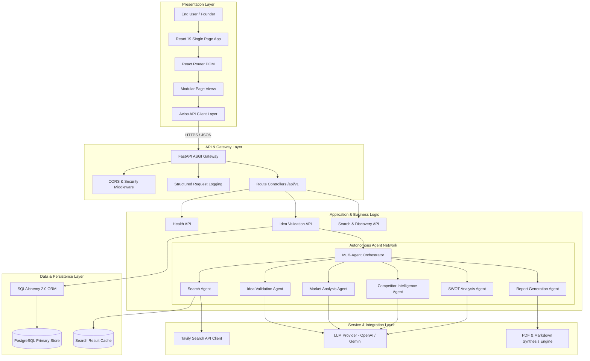

# Architecture Design Specification

## 1. System Overview
The **AI-Based Startup Idea Validator with Market Analysis Assistance** is structured as an enterprise-grade, decoupled client-server application adhering to Clean Architecture principles. It facilitates multi-agent AI research, real-time web querying, and synthesis of startup validation dossiers.

---

## 2. High-Level Architectural Diagram

---

## 3. Layered Design Principles

### 3.1 Presentation Layer (Frontend)
- **Component-Driven Hierarchy**: Isolation of reusable design components (buttons, input fields, badges) from stateful domain containers.
- **Service Layer Abstraction**: UI components never make direct HTTP calls; they invoke dedicated service client functions configured with Axios interceptors.
- **Client-Side State**: Kept lightweight using React Context for global application state and local component state for forms and view toggles.

### 3.2 Gateway & Routing Layer (FastAPI)
- **Decoupled Routers**: Every domain entity (health, idea, search) is isolated in its own router file under `app/api/routes/`.
- **Validation Pipeline**: Automatic JSON schema parsing, type coercion, and request validation via Pydantic v2.
- **Centralized Lifespan & Config**: Environment configurations managed through `pydantic-settings` with type safety and default fallbacks.

### 3.3 Multi-Agent AI Core
- **Separation of Concerns**: Each agent is responsible for exactly one analysis facet (idea clarity, web search, market sizing, competitor identification, SWOT matrix, and reporting).
- **Prompt Isolation**: System instructions and prompt templates are decoupled from agent execution logic.
- **Deterministic Schemas**: Agents return strictly structured Pydantic models rather than free-form text.

### 3.4 Data Access Layer
- **SQLAlchemy 2.0**: Declarative ORM models for database persistence.
- **Migration Ready**: Ready for Alembic database version control and migration tracking.

---

## 4. Scalability & Performance Strategy
1. **Asynchronous Execution**: Native `async/await` handling across FastAPI routes and external API clients (HTTPX).
2. **Parallel Agent Execution**: Independent agents (such as Market Agent and Competitor Agent) can execute concurrently once web search data is retrieved.
3. **Stateless Backend**: The FastAPI backend contains no in-memory session state, allowing horizontal autoscaling on Render.
4. **Static CDN Caching**: The React 19 application is compiled into optimized static assets served globally through Vercel's Edge Network.
