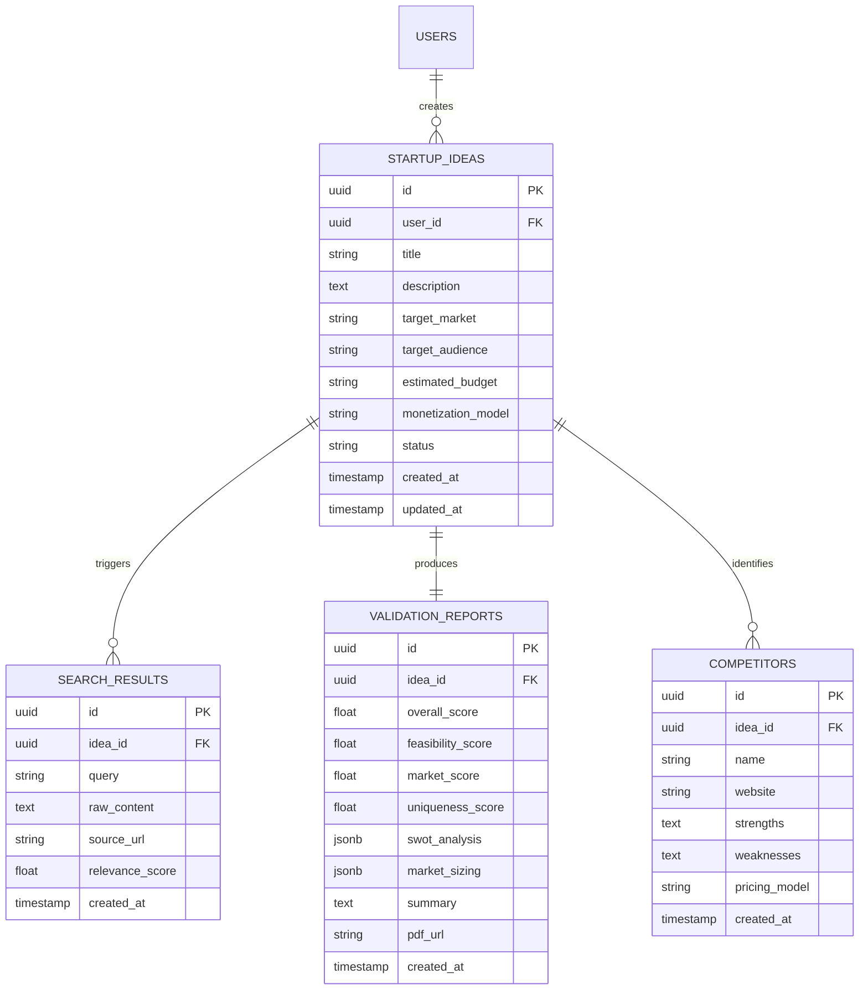

# Data Models & Schema Specification

## 1. Overview
This document specifies the persistence data layer and object schemas for the AI Startup Idea Validator, utilizing **SQLAlchemy 2.0 ORM** for PostgreSQL and **Pydantic v2** for validation.

---

## 2. Entity-Relationship Diagram (ERD)



---

## 3. Database Entities & Columns

### 3.1 Startup Ideas (`startup_ideas`)
- `id` (UUID, Primary Key): Unique identifier.
- `title` (VARCHAR(255), Not Null): Startup name or title.
- `description` (TEXT, Not Null): Elevator pitch and problem description.
- `target_market` (VARCHAR(150), Not Null): Industry domain (e.g., FinTech, HealthTech, EdTech).
- `target_audience` (VARCHAR(255), Nullable): Target demographic or B2B segment.
- `estimated_budget` (VARCHAR(100), Nullable): Capital allocation estimate.
- `monetization_model` (VARCHAR(150), Nullable): Proposed revenue model.
- `status` (VARCHAR(50), Default 'PENDING'): Processing state (`PENDING`, `IN_PROGRESS`, `COMPLETED`, `FAILED`).
- `created_at` (TIMESTAMP): Record creation timestamp.
- `updated_at` (TIMESTAMP): Last modification timestamp.

### 3.2 Search Results (`search_results`)
- `id` (UUID, Primary Key): Unique search item ID.
- `idea_id` (UUID, Foreign Key): References `startup_ideas.id`.
- `query` (VARCHAR(255)): Executed search query.
- `raw_content` (TEXT): Text content retrieved from Tavily.
- `source_url` (VARCHAR(500)): Link to original source.
- `created_at` (TIMESTAMP): Timestamp.

### 3.3 Validation Reports (`validation_reports`)
- `id` (UUID, Primary Key): Unique report ID.
- `idea_id` (UUID, Foreign Key): References `startup_ideas.id`.
- `overall_score` (FLOAT): 0-100 composite index.
- `feasibility_score` (FLOAT): 0-100 feasibility rating.
- `market_score` (FLOAT): 0-100 market demand rating.
- `uniqueness_score` (FLOAT): 0-100 differentiation rating.
- `swot_analysis` (JSONB): Strengths, Weaknesses, Opportunities, Threats.
- `market_sizing` (JSONB): TAM, SAM, SOM metrics and sources.
- `summary` (TEXT): High-level executive evaluation.
- `pdf_url` (VARCHAR(500), Nullable): Path or cloud link to generated PDF.
- `created_at` (TIMESTAMP): Timestamp.

---

## 4. Pydantic Request & Response Data Contracts

### 4.1 IdeaInputSchema
```python
class IdeaInputSchema(BaseModel):
    title: str = Field(..., min_length=3, max_length=200)
    description: str = Field(..., min_length=20, max_length=5000)
    target_market: str = Field(..., min_length=2, max_length=150)
    target_audience: Optional[str] = None
    estimated_budget: Optional[str] = None
    monetization_model: Optional[str] = None
```

### 4.2 StandardApiResponse
```python
class ApiResponse(BaseModel, Generic[T]):
    success: bool
    data: Optional[T] = None
    message: str = "Operation completed"
    errors: Optional[List[Dict[str, Any]]] = None
```
