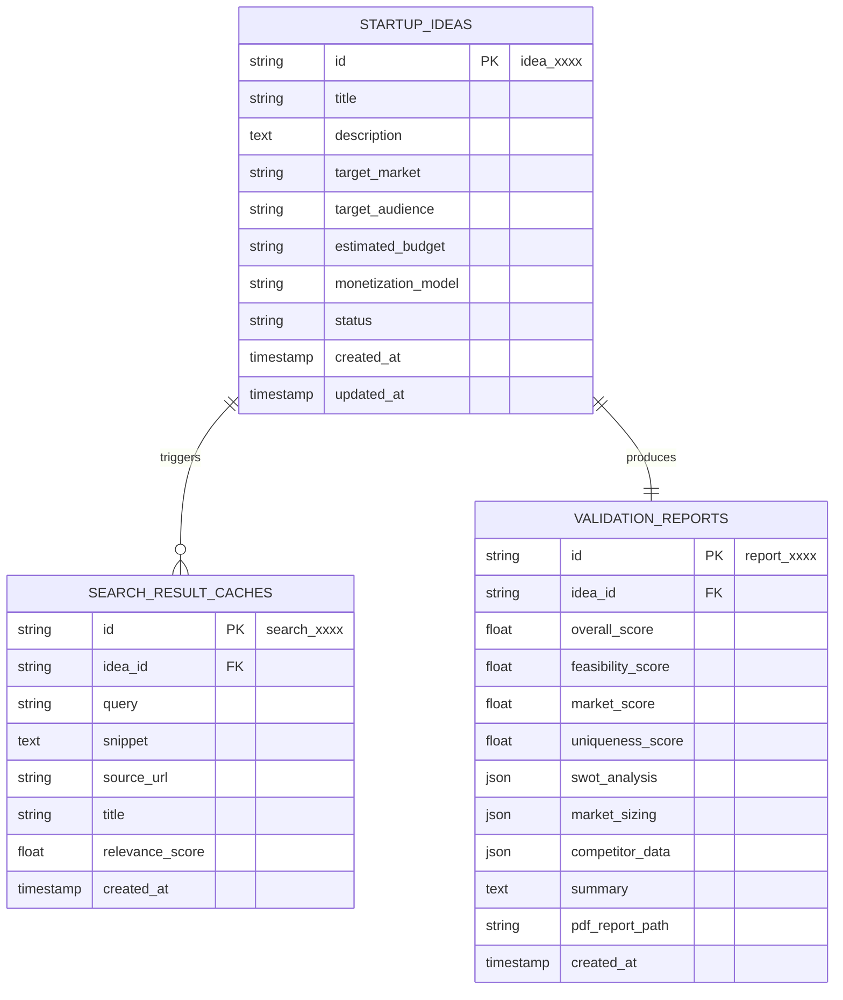

# Data Models & Schema Specification

## 1. Overview
This document specifies the domain entity models and future persistence schemas for the **AI Startup Idea Validator**.

Project Context: **Infosys Springboard Virtual Internship 7.0**

### Strategic Database Decision (Milestone 1)
- **Milestone 1 Runtime**: Uses clean in-memory domain entity dataclasses (`StartupIdea`, `ValidationReport`, `SearchResultCache`). No PostgreSQL server or database credentials are required. The project starts instantly and runs with zero database overhead.
- **Milestone 5 Persistence**: The in-memory domain entities directly map to PostgreSQL relational tables managed by SQLAlchemy 2.0 ORM and Alembic migrations.

---

## 2. Entity-Relationship Diagram (Target Milestone 5 Schema)

---

## 3. Domain Entities & Field Definitions

### 3.1 Startup Idea (`StartupIdea`)
- `id` (str, Unique ID): Short identifier, e.g. `idea_a1b2c3d4`.
- `title` (str, Required): Name or working title of the startup venture.
- `description` (str, Required): Elevator pitch and core problem-solution explanation.
- `target_market` (str, Required): Primary industry or market vertical.
- `target_audience` (str, Optional): Target demographic or B2B customer profile.
- `estimated_budget` (str, Optional): Initial planned capital outlay.
- `monetization_model` (str, Optional): Proposed revenue mechanism (e.g., B2B SaaS).
- `status` (str, Default 'PENDING'): Processing lifecycle state (`PENDING`, `IN_PROGRESS`, `COMPLETED`, `FAILED`).
- `created_at` (datetime): Timestamp when idea was submitted.
- `updated_at` (datetime): Timestamp of latest modification.

### 3.2 Validation Report (`ValidationReport`)
- `id` (str, Unique ID): Short identifier, e.g. `report_a1b2c3d4`.
- `idea_id` (str, Foreign Identifier): Associated startup idea ID.
- `overall_score` (float, 0–100): Composite idea viability score.
- `feasibility_score` (float, 0–100): Technical and operational feasibility rating.
- `market_score` (float, 0–100): Market size and consumer demand rating.
- `uniqueness_score` (float, 0–100): Differentiation against competitors.
- `swot_analysis` (dict): Structured strengths, weaknesses, opportunities, threats.
- `market_sizing` (dict): TAM, SAM, SOM metrics.
- `competitor_data` (list): Identified competitors and differentiators.
- `summary` (str, Optional): Executive synthesis of evaluation findings.
- `pdf_report_path` (str, Optional): Path or URL to rendered PDF report.
- `created_at` (datetime): Creation timestamp.

### 3.3 Search Result Cache (`SearchResultCache`)
- `id` (str, Unique ID): Short identifier, e.g. `search_a1b2c3d4`.
- `idea_id` (str, Optional): Associated startup idea ID if generated during validation.
- `query` (str, Required): Executed web search query.
- `source_url` (str, Optional): URL of web source.
- `title` (str, Optional): Article or website title.
- `snippet` (str, Required): Content snippet extracted from search result.
- `relevance_score` (float): Relevance ranking (0.0 to 1.0).
- `created_at` (datetime): Timestamp when result was fetched.

---

## 4. API Request & Response Schemas (Pydantic v2)
The HTTP interface is strictly enforced via Pydantic models in `app/schemas/idea_schema.py` and `app/schemas/response_schema.py`:
- `IdeaCreateRequest`: Validates incoming user submissions.
- `IdeaValidationResponse`: Serializes comprehensive multi-agent validation dossiers.
- `MarketSearchRequest`: Validates market search queries.
- `MarketSearchResponse`: Serializes search snippets.
- `ApiResponse[T]`: Universal generic response wrapper ensuring `{ success, data, message, errors }`.
