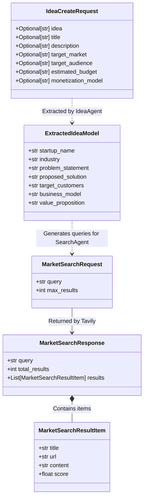

# Data Models & Schema Specification

**Project:** AI-Based Startup Idea Validator with Market Analysis Assistance  
**Program:** Infosys Springboard Virtual Internship 7.0 — Milestone 1  
**Scope:** Milestone 1 Core Models & Future Planned Data Schemas  

---

## 1. Overview

This document specifies the core data models, request/response contracts, and schema validations implemented in Milestone 1 of the **AI Startup Idea Validator**.

### Strategic Database Decision (Milestone 1)
* **Zero Database Overhead**: In Milestone 1, the system does NOT use PostgreSQL or any external database.
* **In-Memory & Pure HTTP Processing**: All request validation, attribute extraction, and search result aggregation operate strictly in-memory using strongly typed **Pydantic v2** models.
* **Future Migration Ready**: The schema definitions are decoupled and structured to map directly to relational database tables in future development phases.

---

## 2. Milestone 1 Core Data Models



---

## 3. Schema Definitions

### 3.1 Startup Idea Models (`app/schemas/idea_schema.py`)

#### A. Submission Request Model (`IdeaCreateRequest`)
Represents the incoming founder payload. Supports both single-text submission (e.g. natural language idea description) and structured fields:
```python
class IdeaCreateRequest(BaseModel):
    idea: Optional[str] = Field(
        default=None,
        description="Raw natural language startup idea description",
        max_length=5000,
    )
    title: Optional[str] = Field(
        default=None,
        max_length=150,
        description="Optional startup title or name",
    )
    description: Optional[str] = Field(
        default=None,
        max_length=5000,
        description="Detailed startup description",
    )
    target_market: Optional[str] = Field(
        default=None,
        max_length=100,
        description="Target industry sector",
    )
    target_audience: Optional[str] = Field(
        default=None,
        max_length=100,
        description="Intended customer profile",
    )
    estimated_budget: Optional[str] = Field(
        default=None,
        max_length=50,
        description="Initial budget range",
    )
    monetization_model: Optional[str] = Field(
        default=None,
        max_length=50,
        description="Revenue / business model",
    )
```

#### B. Extracted Idea Model (`ExtractedIdeaModel`)
The structured output produced by `IdeaAgent` via the LLM:
* `startup_name` (str): Working brand or project name.
* `industry` (str): Primary industry categorization.
* `problem_statement` (str): Core pain point identified.
* `proposed_solution` (str): Technical or operational solution.
* `target_customers` (str): Specific user persona or demographic.
* `business_model` (str): Commercial monetization strategy.
* `value_proposition` (str): Unique selling proposition (USP).

---

### 3.2 Search Result Models (`app/schemas/idea_schema.py`)

#### A. Market Search Request (`MarketSearchRequest`)
Accepts query parameters for targeted web intelligence:
```python
class MarketSearchRequest(BaseModel):
    query: str = Field(
        ...,
        min_length=2,
        max_length=500,
        description="Search query string",
    )
    max_results: int = Field(
        default=5,
        ge=1,
        le=20,
        description="Maximum number of search results to retrieve",
    )
```

#### B. Search Result Item Model (`MarketSearchResultItem`)
Represents an individual real-world market intelligence result from Tavily:
```python
class MarketSearchResultItem(BaseModel):
    title: str = Field(..., description="Title of the search result")
    url: str = Field(..., description="Verified HTTP/HTTPS URL")
    content: str = Field(..., description="Contextual snippet extracted from the web page")
    score: float = Field(default=0.0, ge=0.0, le=1.0, description="Relevance confidence score")
```

#### C. Market Search Response (`MarketSearchResponse`)
Encapsulates aggregated search intelligence:
```python
class MarketSearchResponse(BaseModel):
    query: str = Field(..., description="Original search query executed")
    total_results: int = Field(..., description="Count of returned results")
    results: List[MarketSearchResultItem] = Field(default_factory=list)
```

---

## 4. Standard API Envelope (`app/schemas/response_schema.py`)

All API responses adhere to a consistent enterprise response envelope:
```json
{
  "success": true,
  "data": { ... },
  "message": "Operation completed successfully",
  "errors": null
}
```
In the event of a configuration or validation error, the API returns:
```json
{
  "error": "GROQ_API_KEY not configured."
}
```

---

## 5. Future Planned Features (Milestone 2 and Beyond)

The following persistence models and schemas are planned for subsequent milestones:

1. **Persistent Database Entities (PostgreSQL via SQLAlchemy 2.0)**:
   * `StartupIdeaEntity`: Relational table storing founder submissions, timestamping, and user associations.
   * `SearchResultCacheEntity`: Database table caching Tavily search queries and result items with TTL (Time-to-Live) expiration.
   * `ValidationReportEntity`: Storage for generated SWOT matrices, market sizing estimates, and PDF URLs.
2. **User Authentication & Accounts**:
   * User management, OAuth2 JWT bearer tokens, and historical idea tracking per user account.
3. **Report Generation Models**:
   * Multi-page PDF generation schemas and downloadable report links.
